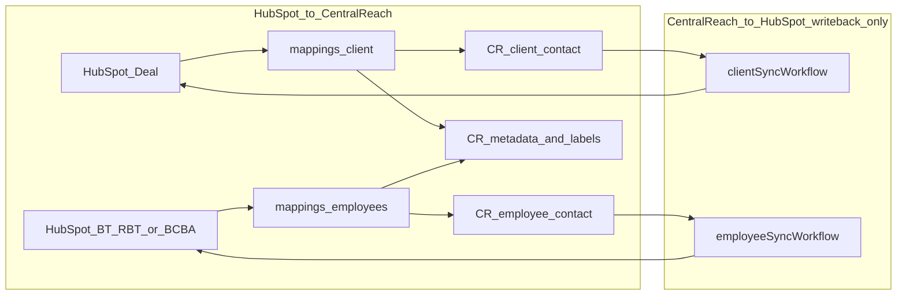

# HubSpot ↔ CentralReach field mappings: current state and change detection

Documentation of field mappings, transforms, and **change detection** implemented in the Azure Central Reach integration **as of the current codebase** (reference as of **2026-10-27**). This describes what runs today, not planned changes.

**Business source of truth (field map, triggers, labels):** [Google Drive — Optidge V2](https://docs.google.com/document/d/1TnUrUUUWuTQv9hLOaZdmM9YD9va2eKXIoAtw_puiYyk/edit). See [`docs/SOURCE-OF-TRUTH.md`](SOURCE-OF-TRUTH.md). When this file and Google Drive differ, the Drive doc wins for *what we should build*; this file wins for *what the repo does now*.

**Sandbox trigger (Oct 25, 2026):** On portal `50850427`, the primary path is a HubSpot workflow webhook, `POST /api/hubspot-webhook`. The body is `objectTypeId` and `recordId` only. Azure reads the mapped values. `intakePoller` is disabled on `centralreachserverless` **today**. That is the current app setting, not the finished architecture. Sandbox end-to-end turns the timer on and proves a poller-only sync through the same queues. See [`poller-backup-contract.md`](poller-backup-contract.md), [`CHECKPOINT.md`](CHECKPOINT.md), and `.cursor/skills/verify-azure-central-reach/SANDBOX-DONE.md`.

**Source of truth in code:** mapping modules under `src/mappings/`, constants in `src/constants/centralReach.mjs`, orchestration in `src/workflows/`.

**How metadata/label IDs were discovered (sandbox CLI + JSON exports):** [`centralreach-metadata-and-labels-discovery.md`](centralreach-metadata-and-labels-discovery.md).

---

## What we established

- **Business and clinical fields** flow **HubSpot → CentralReach** (Deals → client contacts; BT/RBT and BCBA custom objects → employee contacts, plus CR metadata and labels).
- **HubSpot writeback** after a sync is limited to: CentralReach contact ID, CentralReach profile URL, and integration sync status fields (`last_sync_*`, `integration_last_write`, `updated_by_integration`).
- There is **no mapping layer** that reads CentralReach business/clinical fields and writes them back into HubSpot properties.

### Record families

| HubSpot | CentralReach | Mapping modules |
| --- | --- | --- |
| Deal | Client contact + metadata + labels | `buildClientPayload` + `buildClientMetadata` |
| BT/RBT custom object | Employee contact + metadata + labels | `buildEmployeePayload` (BT/RBT branch) |
| BCBA custom object | Employee contact + metadata + labels | `buildEmployeePayload` (BCBA branch) |

### Runtime flow

1. **Webhook (primary, sandbox):** `POST /api/hubspot-webhook` checks signature v2 and enqueues the record id. A repeat notice during an in-flight refresh is still enqueued. Cases go to `client-sync-queue`. BCBA and BT/RBT go to `employee-sync-queue`.
2. **Timer (backup):** `src/functions/intakePoller.mjs` → `src/workflows/intakePollerWorkflow.mjs` searches HubSpot and enqueues the same two queues. `AzureWebJobs.intakePoller.Disabled` is true on the app today. Sandbox end-to-end enables it and proves one poller-only sync. The workers are the same path the webhook uses.
3. **Queue workers (enabled):** `processClientQueue` and `processEmployeeQueue`.
4. **Sync:** `src/workflows/clientSyncWorkflow.mjs` or `src/workflows/employeeSyncWorkflow.mjs` maps fields and calls CentralReach. Both initiators use this path.
5. **Writeback:** Same workflows patch HubSpot with the CentralReach contact id, profile link, and `last_sync_*` fields only (see sections 4 and 8).

### Mapping files (contract today)

| File | Role |
| --- | --- |
| `src/mappings/client/buildClientPayload.mjs` | Deal → CR client contact body (PascalCase API keys) |
| `src/mappings/client/buildClientMetadata.mjs` | Deal → CR client metadata field IDs + client label IDs |
| `src/mappings/client/validateClientPayload.mjs` | Requires `FirstName` and `LastName` on client payload |
| `src/mappings/employees/buildEmployeePayload.mjs` | BT/RBT or BCBA → CR employee body + metadata + label IDs |
| `src/mappings/employees/validateEmployeePayload.mjs` | Requires `externalSystemId` and at least one name |
| `src/constants/centralReach.mjs` | CentralReach metadata field IDs and label IDs |

### Orchestration

- **Client sync:** `src/workflows/clientSyncWorkflow.mjs` — HubSpot property fetch list: `REQUIRED_DEAL_PROPERTIES`.
- **Employee sync:** `src/workflows/employeeSyncWorkflow.mjs` — fetch lists: `BT_RBT_PROPERTIES`, `BCBA_PROPERTIES`.
- HubSpot object-type constants live in `src/constants/hubspot.mjs`; **property names for sync are not centralized there** — they live in the workflows and mapping files above.

**Production sensitive-data tier (portal `50317927`, Integration V2 API rule #2).** The webhook body is the record id only. `REQUIRED_DEAL_PROPERTIES` is the GET that reads the values. Production needs `crm.objects.deals.sensitive.read` or HubSpot omits them. Writes need `crm.objects.deals.sensitive.write`. Portal `50850427` is a developer test account and cannot mark properties sensitive. Fetched Case fields that are sensitive in production: `phi_first_name__cloned_`, `phi_last_name`, `phi_gender`, `phi_date_of_birth`, `insurance_id_1`, `insurance_id_2`, `phi__policy_holder_dob`, `phi_diagnosis` (HIPAA). Sensitive and not fetched: `insurance_id_3`, `insurance_id_4`. BT/RBT and BCBA properties, including `medicaid_id__ny`, `medicaid_id__nj`, and `medicaid_id__co`, are not in that tier. Tracker: [`Sandbox props & labels_summary.md`](Sandbox%20props%20%26%20labels_summary.md).

### Environment configuration

Sandbox vs production HubSpot pipeline IDs, custom object type IDs, and stage allowlists are supplied via **environment variables** (`src/lib/config.mjs`, e.g. `local.settings.json`). Mapping files do not contain commented sandbox/production ID pairs.

---

## Client (deal) intake trigger — HubSpot polling logic

Azure does **not** watch a single HubSpot property named “intake complete.” For **cases (deals)**, the timer poller treats a record as eligible when it is in a configured **deal pipeline** and **deal stage** (HubSpot’s `dealstage` internal ID). In operations, those stage IDs are the ones that correspond to **Intake Complete** (and any other stages you include in the allowlist).

The primary entry point in sandbox is `POST /api/hubspot-webhook` (`src/functions/hubspotWebhook.mjs`). A HubSpot workflow sends only `objectTypeId` and `recordId`. Azure checks the legacy private-app signature v2 and enqueues the same client or employee sync. The poller schedule and stage filters below are unchanged, and that timer is disabled in sandbox.

### Schedule and entrypoint

| Item | Value |
| --- | --- |
| Azure Function | `intakePoller` (`src/functions/intakePoller.mjs`) |
| Schedule | Every **5 minutes** — cron `0 */5 * * * *` |
| Workflow | `runIntakePollerWorkflow` (`src/workflows/intakePollerWorkflow.mjs`) |
| Manual test (local/dev) | `POST /api/intake-poller-test` (`src/functions/intakePollerHttpTest.mjs`) |

### HubSpot search filters (deal candidates)

Implemented in `searchIntakeCompleteDeals` → `searchCustomObjectRecords` (`src/lib/hubspotClient.mjs`), object type **`deals`**.

| HubSpot property | Operator | Source | Purpose |
| --- | --- | --- | --- |
| `pipeline` | `EQ` | Env `HS_DEAL_PIPELINE_ID` | Limit to the case/deal pipeline |
| `dealstage` | `IN` | Env `HS_STAGE_ALLOWLIST_JSON` (JSON array of stage **internal IDs**) | Stages that count as eligible (e.g. Intake Complete and any other configured stages) |
| `hs_lastmodifieddate` | `GTE` | Rolling window: `LOOKBACK_MINUTES` (default **15**) | Optional time window; if HubSpot rejects this filter, search retries **without** lookback |

Search returns these deal properties only: `hs_object_id`, `hs_lastmodifieddate`, `integration_last_write`.

Sort: `hs_lastmodifieddate` descending. Pagination capped by `MAX_DEALS_PER_RUN` and `MAX_SEARCH_REQUESTS_PER_SECTION` (config).

> **Note:** The function name `searchIntakeCompleteDeals` describes the **business intent**. The code keys off **`dealstage` IDs** in `HS_STAGE_ALLOWLIST_JSON`, not a custom deal property whose label is “Intake Complete.” Map your HubSpot stage(s) to those IDs in Function App / `local.settings.json`.

### Per-deal gates after search (`shouldSyncDeal`)

For each search result, `intakePollerWorkflow` enqueues client sync only if **all** of the following pass:

| Step | Rule |
| --- | --- |
| Record identity | `dealId` and `hs_lastmodifieddate` must be present |
| Change vs integration | `shouldSyncDeal`: if `integration_last_write` is empty → **sync**; else sync only when `hs_lastmodifieddate` **>** `integration_last_write` |
| Dedupe | Cosmos key `dedupe:client-sync` / `{dealId}:{hsLastModifiedDate}` must not already exist (TTL from `DEDUPE_TTL_SECONDS`) |
| Concurrency | Single poller run holds Cosmos lease `workflow:intake-poller` / `active-lease` |

When enqueued, Service Bus message includes `dealId`, `hsLastModifiedDate`, `workflow: clientSync`, `source: intakePoller` → `processClientQueue` → `runClientSyncWorkflow`.

### HubSpot properties involved in triggering (not mapped to CR)

| HubSpot property | Role in trigger |
| --- | --- |
| `pipeline` | Search filter — must match configured pipeline ID |
| `dealstage` | Search filter — must be in stage allowlist (Intake Complete stage IDs) |
| `hs_lastmodifieddate` | Lookback filter + must be newer than integration write for re-sync |
| `integration_last_write` | Compared to `hs_lastmodifieddate` in `shouldSyncDeal`; updated by client sync writeback after CR upsert |

After a client sync, including a `noop`, the workflow sets `integration_last_write` and `updated_by_integration`. The value comes from the Azure clock before the PATCH. HubSpot stamps `hs_lastmodifieddate` when it applies the PATCH, so the sweep can re-enqueue the deal on the next tick. See [`poller-backup-contract.md`](poller-backup-contract.md).

### Related env vars (deals / intake)

| Variable | Role |
| --- | --- |
| `HS_DEAL_PIPELINE_ID` | Deal pipeline for intake search |
| `HS_STAGE_ALLOWLIST_JSON` | JSON array of eligible `dealstage` internal IDs |
| `LOOKBACK_MINUTES` | Modified-since window for search (optional) |
| `MAX_DEALS_PER_RUN` | Max deals returned per poller run |
| `CLIENT_SYNC_QUEUE_NAME` | Service Bus queue for client sync messages |
| `DEDUPE_TTL_SECONDS` / `LEASE_TTL_SECONDS` | Cosmos dedupe and poller lease TTL |

*(The same poller also searches BT/RBT and BCBA custom objects by `hs_pipeline` / `hs_pipeline_stage` allowlists; that path is separate from deal intake complete.)*

---

## Change detection (current codebase)

Two layers decide whether HubSpot activity becomes a CentralReach write. Webhooks do **not** filter on specific property names — they enqueue by `objectTypeId` + `recordId` only. Field-level decisions happen in the poller gates and sync workflows.

| Layer | Question | Where |
| --- | --- | --- |
| **1. Eligibility** | Should this record be enqueued? | Initial poller search still uses pipeline/stage allowlists plus `hs_lastmodifieddate` vs `integration_last_write`. A separate linked-record recheck (`LINKED_RECHECK_ENABLED`, default on when the poller runs) pages records that already have a CentralReach id, with no stage or timestamp filter. The poller timer is disabled on the app today. Sandbox end-to-end turns it on. |
| **2. Content hash** | Did the mapped state change? | Webhook and poller workers compare one SHA-256 of core payload, explicit metadata blanks, label ids, and (clients) staffing association ids. Employee workers no longer return before that comparison because the parent timestamp is older than `integration_last_write`. |

### Layer 1 — Eligibility fields (any HubSpot modification)

Rule for all three families: if `integration_last_write` is empty → **sync**; else sync only when `hs_lastmodifieddate` **>** `integration_last_write`.

| Entity | HubSpot fields checked | Notes |
| --- | --- | --- |
| **Client (Deal)** | `hs_lastmodifieddate`, `integration_last_write` | Poller search also returns `hs_object_id`. Stage/pipeline filters are eligibility for *finding* candidates, not change detection. |
| **BT/RBT** | `hs_lastmodifieddate`, `integration_last_write` | Same comparison as deals (`shouldSyncBtRbt` → `shouldSyncDeal`). |
| **BCBA** | `hs_lastmodifieddate`, `integration_last_write`, `updated_by_integration` | Reads `updated_by_integration`; both branches still require last-modified newer than last write. |

These properties are **not** mapped to CentralReach. After a `success` or `noop` writeback (employees also on `blocked`), the workflow sets `integration_last_write` and usually `updated_by_integration`. The writeback PATCH itself moves `hs_lastmodifieddate` past that value, so it does not reliably block a sweep re-enqueue. See [`poller-backup-contract.md`](poller-backup-contract.md).

### Layer 2 — Content hash fields (`last_sync_hash`)

Hash is SHA-256 of a stable-sorted JSON payload. Match + existing CR contact id → contact body PUT can **noop**.

#### Client (Deal) — contact body, metadata, labels, and staffing associations

**Code:** `hashMappedState` of `{ core, metadata, labels, relationships }` vs deal `last_sync_hash`.  
On a full hash match, the contact PUT and the metadata/label writes are skipped. A metadata clear is attempted with HTTP DELETE only when a previously synced metadata value becomes blank. Empty-string PUT is not used as a clear. DELETE responses 400, 405, and 501 are recorded as `clear_unsupported` and do not advance `last_sync_hash`. Staffing comparison uses association ids and type ids from the v4 associations API, not name fields. Unlabeled and candidate-only type ids are excluded.

| HubSpot property | Role in hash |
| --- | --- |
| `hs_object_id` / deal `id` | `ExternalSystemId` |
| `phi_first_name__cloned_` | `FirstName` |
| `phi_last_name` | `LastName` |
| `phi_date_of_birth` | `DateOfBirth` |
| `phi_gender` | `Gender` |
| `email` | `PrimaryEmail` |
| `phone` | `PhoneCell` |
| `phone_number__second_` | `PhoneHome` |
| `if_services_will_be_in_more_than_one_location__list_the_other_addres` or `street_address` | `AddressLine1` |
| `home_apt` | `AddressLine2` |
| `location_city` | `City` |
| `location_central_reach` or `location` | `StateProvince` |
| `postal_code` | `ZipPostalCode` |
| `guardian_first_name` | `GuardianFirstName` |
| `guardian_last_name` | `GuardianLastName` |

Also hashed as constants/config on the payload: `ContactForm` (from env / default).

#### BT/RBT — employee body, metadata, and labels

**Code:** `hashMappedState({ employee, metadata, labels })` vs record `last_sync_hash`.  
Label ids are in the hash. Mapped metadata keys are stored as explicit null when blank, except the HubSpot record link when the portal id is not configured (that field is omitted, not cleared).

| HubSpot property | Role in hash |
| --- | --- |
| `hs_object_id` / record `id` | `externalSystemId` |
| `bt_name` | `firstName`, `lastName` |
| `gender` | `gender` |
| `date_of_birth` | `dateOfBirth` |
| `email` | `primaryEmail` |
| `street_home` | `addressLine1` |
| `home_apt` | `addressLine2` |
| `location_city` | `city` |
| `location_home` | `stateProvince` |
| `postal_code_home` or `postal_code` | `zipPostalCode` |
| `employee_phone` | `phoneCell` |
| `street_address__work_`, `city__work_`, `state__work_`, `postal_code__work_` | Work address metadata (`133819`) when non-empty |
| `hs_object_id` (+ portal / object type) | HubSpot record link metadata (`138703`) when portal id is set |

#### BCBA — employee body, metadata, and labels

**Code:** same `{ employee, metadata, labels }` hash as BT/RBT. Blank mapped metadata is part of the hash. The HubSpot record link is omitted, not cleared, when the portal id is not configured.

| HubSpot property | Role in hash |
| --- | --- |
| `hs_object_id` / record `id` | `externalSystemId` |
| `bcba_name` | `firstName`, `lastName` |
| `date_of_birth` | `dateOfBirth` |
| `work_email` | `primaryEmail` |
| `address` | `addressLine1` |
| `home_apt` | `addressLine2` |
| `city_work` | `city` |
| `home_state` | `stateProvince` |
| `employee_phone` | `phoneCell` |
| `email` | BCBA email metadata (`138069`) |
| `medicaid_id__ny` | metadata `126216` |
| `medicaid_id__nj` | metadata `138112` |
| `medicaid_id__co` | metadata `138113` |
| `credentialed_insurances__ny` | metadata `134444` |
| `hs_object_id` (+ portal / object type) | HubSpot record link metadata (`138703`) when portal id is set |

### Practical implication

- Layer 1 treats **any** HubSpot record edit (that bumps `hs_lastmodifieddate`) as a candidate once past stage/pipeline filters.
- Layer 2 decides whether the **mapped CR payload** changed. A deal metadata-only change can still refresh CR metadata while leaving the client contact body on noop. An employee metadata-only change **does** change the hash and prevents a full noop.

---

## How to read the tables

| Column | Meaning |
| --- | --- |
| **HubSpot property** | Internal HubSpot property name as fetched or patched by the integration |
| **CR field / source** | Exact CentralReach target as used by this integration (see below) |
| **Transform** | Normalization, concatenation, or conditional logic applied in mapping code |
| **Direction** | `HubSpot → CentralReach` or `CentralReach → HubSpot` |

**CR field / source column — what appears where**

| Target type | What to list in **CR field / source** | Where it goes in CR |
| --- | --- | --- |
| **Client contact body** | Exact JSON property name on `POST/PUT /contacts/client` (**PascalCase**, e.g. `FirstName`, `PrimaryEmail`) | Request body |
| **Employee contact body** | Exact JSON property name on employee create/update (**camelCase**, e.g. `firstName`, `primaryEmail`; create also sends **`ContactForm`** PascalCase) | Request body |
| **Metadata** | Friendly CR field name plus numeric ID (e.g. Allergies `126214`) — value sent as `inputValue` on `PUT .../metadata/{fieldId}` | URL path `{fieldId}` |
| **Labels** | **Numeric label ID only** (e.g. `1052619`) — sent as `{ labelId }` in `POST .../labels` body | Labels API |
| **Writeback to HubSpot** | CR **`contactId`** (or equivalent) from create/update **response** (`extractCrContactId` in `centralReachClient.mjs`), not a HubSpot-mapped CR metadata field | Integration workflow only |

Constant keys in `src/constants/centralReach.mjs` (e.g. `ALLERGIES`) match the friendly names used in metadata tables below.

> **Note:** On forward sync, CentralReach metadata updates **skip** null or blank values (`updateMetadataField` in `src/lib/centralReachClient.mjs`). Empty HubSpot values do not clear existing CR metadata.

---

## 1. Client — Deal → CR client contact

**Mapper:** `src/mappings/client/buildClientPayload.mjs`  
**CentralReach API:** `POST /contacts/client` or `PUT /contacts/client/{contactId}`  
**Direction:** HubSpot → CentralReach (all rows)

| HubSpot property | CR field / source | Transform | Direction |
| --- | --- | --- | --- |
| *(env `CR_CLIENT_CONTACT_FORM`)* | `ContactForm` | Default `"Public Client Intake Form"` if env unset | HubSpot → CentralReach |
| `hs_object_id` or deal `id` | `ExternalSystemId` | String of HubSpot deal record ID | HubSpot → CentralReach |
| `phi_first_name__cloned_` | `FirstName` | Passthrough; required for validation | HubSpot → CentralReach |
| `phi_last_name` | `LastName` | Passthrough; required for validation | HubSpot → CentralReach |
| `phi_date_of_birth` | `DateOfBirth` | Parsed to UTC midnight ISO: `YYYY-MM-DDT00:00:00.000Z` | HubSpot → CentralReach |
| `phi_gender` | `Gender` | `male` → `Male`, `female` → `Female`; otherwise `null` | HubSpot → CentralReach |
| `email` | `PrimaryEmail` | Trim, lowercase; invalid email format → `null` | HubSpot → CentralReach |
| `phone` | `PhoneCell` | Digits only; 11 digits starting with `1` → drop leading `1`; must be 10 digits or `null` | HubSpot → CentralReach |
| `phone_number__second_` | `PhoneHome` | Same phone normalization as `PhoneCell` | HubSpot → CentralReach |
| `full_home_address`, `service_address__other`, `if_services_will_be_in_more_than_one_location__list_the_other_address`, or `street_address` | `AddressLine1` | First non-empty, in that order. The truncated `addres` name is not a property on portal `50317927` or `50850427`. | HubSpot → CentralReach |
| `home_apt` | `AddressLine2` | Passthrough | HubSpot → CentralReach |
| `location_city` | `City` | Passthrough | HubSpot → CentralReach |
| `stateregion`, `location_central_reach`, or `location` | `StateProvince` | First non-empty. US state name or 2-letter code → 2-letter uppercase code | HubSpot → CentralReach |
| `postal_code` | `ZipPostalCode` | Passthrough | HubSpot → CentralReach |
| `guardian_first_name` | `GuardianFirstName` | Passthrough | HubSpot → CentralReach |
| `guardian_last_name` | `GuardianLastName` | Passthrough | HubSpot → CentralReach |

---

## 2. Client metadata — Deal → CR metadata fields

**Mapper:** `src/mappings/client/buildClientMetadata.mjs`  
**CentralReach API:** `PUT /contacts/{contactId}/metadata/{fieldId}` (and label POST via `updateClientMetadata`)  
**Direction:** HubSpot → CentralReach (all rows)

| HubSpot property | CR field / source | Transform | Direction |
| --- | --- | --- | --- |
| `allergies` | Allergies (`126214`) | Trim; empty → skip write | HubSpot → CentralReach |
| `maladaptive_behaviors__clinical` | Maladaptive behaviors (`126207`) | Trim | HubSpot → CentralReach |
| `comorbid_diagnosis__clinical` | Comorbid diagnosis (`132303`) | Trim | HubSpot → CentralReach |
| `current_primary_bt` | BT 1 name (`131313`) | Trim | HubSpot → CentralReach |
| `current_primary_bt_2` | BT 2 name (`138092`) | Trim | HubSpot → CentralReach |
| `bt_work_schedule_confirmed` | Work schedule 1 (`132304`) | Trim | HubSpot → CentralReach |
| `bt_work_schedule_2_confirmed` | Work schedule 2 (`138093`) | Trim | HubSpot → CentralReach |
| `client_availability_completed` | Client availability (`126209`) | Trim | HubSpot → CentralReach |
| `assigned_hours` | Total assigned hours (`134331`) | Trim (string) | HubSpot → CentralReach |
| `authorized_hours` | Approved auth hours (`132431`) | Trim | HubSpot → CentralReach |
| `auth_start_date`, `auth_end_date` | Auth period (`134672`) | Each date → `MM/DD/YYYY`; both present → `"start - end"`; one only → that value | HubSpot → CentralReach |
| `physician_name`, `npi_number` | Physician credentials (`131151`) | Only when `n1_what_type_of_insurance` is `medicaid ffs` (case-insensitive). Join non-empty parts with `", "` | HubSpot → CentralReach |
| `physician_name__commercial`, `npi_number__commercial` | Physician credentials (`131151`) | Only when `n1_what_type_of_insurance` is `commercial enrolled` or `commercial oon`. Join with `", "` | HubSpot → CentralReach |
| `most_recent_asd_diagnosis_date_medicaid` | ASD diagnosis date (`131195`) | Only when `n1_what_type_of_insurance` is `medicaid ffs` → `MM/DD/YYYY` | HubSpot → CentralReach |
| `most_recent_asd_diagnosis_date_1` | ASD diagnosis date (`131195`) | Only when `n1_what_type_of_insurance` is commercial enrolled/oon → `MM/DD/YYYY` | HubSpot → CentralReach |
| `most_recent_asd_diagnosis_date_medicaid` | ASD diagnosis date secondary (`138701`) | Only when **`n2_what_type_of_insurance`** is `medicaid ffs` → `MM/DD/YYYY` | HubSpot → CentralReach |
| `most_recent_asd_diagnosis_date_2` | ASD diagnosis date secondary (`138701`) | Only when **`n2_what_type_of_insurance`** is commercial enrolled/oon → `MM/DD/YYYY` | HubSpot → CentralReach |
| `supervising_bcba` | Supervising BCBA (`131308`) | Trim | HubSpot → CentralReach |
| `initial_assessment_bcba` | Initial assessment BCBA (`131314`) | Trim | HubSpot → CentralReach |
| `severity_level_clinical` | Severity level (`133826`) | Trim | HubSpot → CentralReach |
| `policy_holder_name` | Policy holder name (`138090`) | Trim | HubSpot → CentralReach |
| `phi__policy_holder_dob` | Policy holder DOB (`137667`) | HubSpot date (epoch or parseable) → `MM/DD/YYYY` | HubSpot → CentralReach |
| `insurance_primary`, `insurance_1__other__summary` | Current insurance (`126210`) | If primary is `Other` (case-insensitive), use other summary or literal `"Other"`; else primary, else other summary | HubSpot → CentralReach |
| `insurance_id_1` | Insurance ID (`131316`) | Trim | HubSpot → CentralReach |
| `insurance_2`, `insurance_2__other__summary` | Secondary insurance (`144600`) | Same Other-summary rule as current insurance | HubSpot → CentralReach |
| `insurance_id_2` | Secondary insurance ID (`144601`) | Trim | HubSpot → CentralReach |
| `hs_object_id` | HubSpot link to case record (`138702`) | Built URL: `https://app.hubspot.com/contacts/{portalId}/record/{dealObjectTypeId}/{dealId}` — portal from `HUBSPOT_PORTAL_ID_TEST` (default `50850427`), object type from `HUBSPOT_DEAL_OBJECT_TYPE_ID` (default `0-3`) | HubSpot → CentralReach |

### HubSpot properties used for branching only (not written to CR)

| HubSpot property | Role |
| --- | --- |
| `n1_what_type_of_insurance` | Selects physician credentials and primary ASD diagnosis date source |
| `n2_what_type_of_insurance` | With `n1_what_type_of_insurance`, selects whether the Medicaid FFS NY diagnosis date (metadata `138701`) is written |

### Fetched on deal but not mapped to CentralReach

| HubSpot property | Notes |
| --- | --- |
| `insurance_id_3`, `insurance_id_4` | Sensitive on production portal `50317927`. Not fetched and not synced. The field map does not use them. |
| `hs_lastmodifieddate` | Used by intake poller / sync eligibility only |
| `integration_last_write`, `updated_by_integration`, `last_sync_*` | Sync control and writeback; see section 4 |

---

## 3. Client labels — Deal state → CR labels

**Mapper:** `requiredClientLabelIdsForState` in `src/mappings/client/buildClientMetadata.mjs`  
**CentralReach API:** `POST /contacts/{contactId}/labels`  
**Direction:** HubSpot → CentralReach (labels are not HubSpot properties)

| HubSpot input | CR field / source | Transform | Direction |
| --- | --- | --- | --- |
| *(always)* | `1052619` (label) | Always applied | HubSpot → CentralReach |
| `location_central_reach` or `location` → NY | `1082499` (label) | State normalized: `ny` or `new york` → NY | HubSpot → CentralReach |
| `location_central_reach` or `location` → CO | `1132648` (label) | State normalized: `co` or `colorado` → CO | HubSpot → CentralReach |
| `insurance_primary` = Aetna and location NY | `1082497` | No label for Aetna in NJ or CO | HubSpot → CentralReach |
| `insurance_primary` = Cigna and location NY / CO | `1082498` / `1124249` | No label for Cigna in NJ | HubSpot → CentralReach |
| `insurance_primary` = Medicaid FFS and location NY / NJ / CO | `1052532` / `1124247` / `1124248` | State comes from location, not the insurance value | HubSpot → CentralReach |
| `insurance_primary` contains Carelon | `1107648` | The nine “-Carelon” options are on sandbox `insurance_primary` (Oct 27, 2026). Anthem BCBS and UHC stay uncoded, waiting on United Care | HubSpot → CentralReach |

---

## 4. Client HubSpot writeback — after CR client sync

**Workflow:** `src/workflows/clientSyncWorkflow.mjs` (`updateDealProperties`)  
**Direction:** CentralReach → HubSpot (all rows)

Values come from the sync result (CR contact ID) or the workflow (timestamps, hash, status). They are not read from CR metadata fields.

| HubSpot property | CR field / source | Transform | Direction |
| --- | --- | --- | --- |
| `HUBSPOT_CR_CONTACT_ID_PROPERTY` (env; fallback `client_id_number`) | `contactId` (CR API response) | String of ID from create/update response (`contactId`, `id`, etc.) | CentralReach → HubSpot |
| `central_reach_link_to_client` | `contactId` (CR API response) | Built URL: `https://members.centralreach.com/#contacts/details/?id={contactId}` | CentralReach → HubSpot |
| `last_sync_hash` | *(integration)* mapped client state | SHA-256 of core payload, metadata, label ids, and staffing association ids (see Layer 2 above) | CentralReach → HubSpot |
| `last_sync_at` | *(integration)* workflow | ISO timestamp | CentralReach → HubSpot |
| `last_sync_status` | *(integration)* workflow | `success`, `noop`, or `error` | CentralReach → HubSpot |
| `last_sync_error` | *(integration)* workflow | Empty string on success; error message (truncated) on failure | CentralReach → HubSpot |
| `integration_last_write` | *(integration)* workflow | ISO timestamp on success path | CentralReach → HubSpot |
| `updated_by_integration` | *(integration)* workflow | Set to `true` on success path | CentralReach → HubSpot |

> **Note:** On a full hash match (`operation: noop`), the contact PUT and the metadata and label writes are all skipped. The HubSpot writeback PATCH still runs.

---

## 5. BT/RBT — custom object → CR employee

**Mapper:** `buildBtRbtPayload` in `src/mappings/employees/buildEmployeePayload.mjs`  
**CentralReach API:** `PUT /contacts/employee/{id}`, `PUT /contacts/employee/byExternalSystemId`, or `POST /contacts/employee` (create)  
**Direction:** HubSpot → CentralReach (all rows)

| HubSpot property | CR field / source | Transform | Direction |
| --- | --- | --- | --- |
| `hs_object_id` or record `id` | `externalSystemId` | String | HubSpot → CentralReach |
| `bt_name` | `firstName`, `lastName` | Split on whitespace: first token / remainder | HubSpot → CentralReach |
| `gender` | `gender` | `male`/`m` → `Male`, `female`/`f` → `Female`; else `null` | HubSpot → CentralReach |
| `date_of_birth` | `dateOfBirth` | `YYYY-MM-DD` or parseable date → ISO date slice `YYYY-MM-DD` | HubSpot → CentralReach |
| `email` | `primaryEmail` | Trim, lowercase | HubSpot → CentralReach |
| `street_home` | `addressLine1` | Trim | HubSpot → CentralReach |
| `home_apt` | `addressLine2` | Trim | HubSpot → CentralReach |
| `location_city` | `city` | Trim | HubSpot → CentralReach |
| `location_home` | `stateProvince` | US state name or code → 2-letter uppercase | HubSpot → CentralReach |
| `postal_code_home` **or** `postal_code` | `zipPostalCode` | Prefer `postal_code_home`, else `postal_code` | HubSpot → CentralReach |
| `employee_phone` | `phoneCell` | Digits; 11 digits with leading `1` → last 10 | HubSpot → CentralReach |
| `street_address__work_`, `city__work_`, `state__work_`, `postal_code__work_` | Work address (`133819`) | `"street, city, state zip"` joined segments; omitted if empty | HubSpot → CentralReach |
| `hs_object_id` | HubSpot link to BT/RBT record (`138703`) | Built URL: `https://app.hubspot.com/contacts/{portalId}/record/{btRbtObjectTypeId}/{recordId}`; omitted if `HUBSPOT_PORTAL_ID` missing (warning logged) | HubSpot → CentralReach |
| *(create only)* | `ContactForm` | Hardcoded `"Behavior Technician NY"` on employee create | HubSpot → CentralReach |
| `bt_rbt_type`, `location_home` | *(label IDs)* | Drives label set; see section 7 | HubSpot → CentralReach |

> **Note:** When updating an existing CR employee by contact ID, `buildEmployeePayloadForContactId` in `src/lib/centralReachClient.mjs` may **replace** mapped `externalSystemId` and `primaryEmail` with values already stored on the CR employee before PUT.

---

## 6. BCBA — custom object → CR employee

**Mapper:** `buildBcbaPayload` in `src/mappings/employees/buildEmployeePayload.mjs`  
**Direction:** HubSpot → CentralReach (all rows)

| HubSpot property | CR field / source | Transform | Direction |
| --- | --- | --- | --- |
| `hs_object_id` or record `id` | `externalSystemId` | String | HubSpot → CentralReach |
| `bcba_name` | `firstName`, `lastName` | Split full name on whitespace | HubSpot → CentralReach |
| `date_of_birth` | `dateOfBirth` | Same date normalization as BT/RBT | HubSpot → CentralReach |
| `work_email` | `primaryEmail` | Trim, lowercase | HubSpot → CentralReach |
| `address` | `addressLine1` | Trim | HubSpot → CentralReach |
| `home_apt` | `addressLine2` | Trim | HubSpot → CentralReach |
| `city_work` | `city` | Trim | HubSpot → CentralReach |
| `home_state` | `stateProvince` | US state → 2-letter code | HubSpot → CentralReach |
| `employee_phone` | `phoneCell` | Phone digit normalization | HubSpot → CentralReach |
| `email` | BCBA email (`138069`) | Trim, lowercase (personal email in metadata; work email on contact `primaryEmail`) | HubSpot → CentralReach |
| `medicaid_id__ny` | BCBA Medicaid ID NY (`126216`) | Trim | HubSpot → CentralReach |
| `medicaid_id__nj` | BCBA Medicaid ID NJ (`138112`) | Trim | HubSpot → CentralReach |
| `medicaid_id__co` | BCBA Medicaid ID CO (`138113`) | Trim | HubSpot → CentralReach |
| `credentialed_insurances__ny` | BCBA credentialed with Medicaid NY (`134444`) | Trim | HubSpot → CentralReach |
| `hs_object_id` | HubSpot link to BCBA record (`138703`) | Same metadata field ID as BT/RBT link; built URL with BCBA object type ID | HubSpot → CentralReach |
| *(create only)* | `ContactForm` | Hardcoded `"Admin"` on employee create | HubSpot → CentralReach |

BCBA employee contact body does **not** map HubSpot zip or gender fields to CentralReach.

---

## 7. Employee labels — HubSpot inputs → CR labels

**Mappers:** `requiredBtRbtLabels`, `requiredBcbaLabels` in `src/mappings/employees/buildEmployeePayload.mjs`  
**Direction:** HubSpot → CentralReach

### BT/RBT

| Condition (HubSpot-driven) | CR field / source (label IDs) |
| --- | --- |
| Always | `1052618` |
| `location_home` → NY | `1052630`, `1052643`, `1132655` |
| NY + `bt_rbt_type` = `RBT` | Also `1052631` |
| `location_home` → CO | `1052643`, `1107687` |
| CO + `bt_rbt_type` = `BT` or `RBT` | Also `1107692` |

State code comes from `location_home` via the same US state normalization used on the employee payload.

### BCBA

| Condition (HubSpot-driven) | CR field / source (label IDs) |
| --- | --- |
| Always | `1052618`, `1130668`, `1052643` |
| `home_state` → NY | `1132655` |
| `home_state` → CO | `1107687` |
| `ny_insurance_labels` contains MCD FFS-NY / Aetna-NY / Cigna-NY / Carelon-NY | `1107647` / `1107649` / `1107650` / `1132654`. `nj_insurance_labels`, Aetna-CO, Cigna-CO, and Carelon-CO stay uncoded |
| `co_insurance_labels` contains MCD-CO | `1107651` |
| `cr_billing_hold_label` = Yes | `1103437`. Added when Yes. The CentralReach client only POSTs labels, so No does not remove a label already on the contact |

---

## 8. Employee HubSpot writeback — after CR employee sync

**Workflow:** `buildWritebackPropertyPatch` in `src/workflows/employeeSyncWorkflow.mjs` (`updateEmployeeWritebackWithFallback` / `updateObjectProperties`)  
**Direction:** CentralReach → HubSpot (all rows)

| HubSpot property | CR field / source | Transform | Direction |
| --- | --- | --- | --- |
| `HUBSPOT_EMPLOYEE_ID_PROPERTY` (env; default `employee_id`) | `contactId` (CR API response) | String of contact ID from create/update | CentralReach → HubSpot |
| `central_reach_link_to_rt_rbt` | `contactId` (CR API response) | Built CR profile URL (BT/RBT records only) | CentralReach → HubSpot |
| `central_reach_record_link` | `contactId` (CR API response) | Built CR profile URL (BCBA records only) | CentralReach → HubSpot |
| `last_sync_hash` | *(integration)* employee JSON, metadata map, and label ids | SHA-256 of stable-sorted `{ employee, metadata, labels }` object | CentralReach → HubSpot |
| `last_sync_at` | *(integration)* workflow | ISO timestamp | CentralReach → HubSpot |
| `last_sync_status` | *(integration)* workflow | `success`, `noop`, `blocked`, or `error` | CentralReach → HubSpot |
| `last_sync_error` | *(integration)* workflow | Empty or blocked reason / error message | CentralReach → HubSpot |
| `integration_last_write` | *(integration)* workflow | Set on `success`, `noop`, or `blocked` | CentralReach → HubSpot |
| `updated_by_integration` | *(integration)* workflow | `true` when `integration_last_write` is set on those statuses | CentralReach → HubSpot |

> **Note:** Employee noop detection uses a hash of **both** the outbound employee contact fields and metadata values. If `employee_id` property is missing in HubSpot, writeback may omit that property and retry without it (`updateEmployeeWritebackWithFallback`).

---

## Callouts (current behavior)

1. **Change detection reference:** Full eligibility + hash field lists are in **[Change detection (current codebase)](#change-detection-current-codebase)** above (as of 2026-10-27).
2. **Hash scope:** Both hashes cover the contact body, metadata, and label ids. The client hash also covers staffing association ids. A full match skips the CentralReach writes and still patches HubSpot bookkeeping.
3. **Employee update preservation:** For records with an existing CR contact ID, outbound PUT may keep CR `externalSystemId` and `primaryEmail` instead of HubSpot-mapped values (`buildEmployeePayloadForContactId`).
4. **Shared metadata ID:** HubSpot record link for employees uses metadata field **`138703`** for both BT/RBT and BCBA (constant names differ in `centralReach.mjs`; ID is the same).
5. **Metadata empty values:** Blank HubSpot values do not send a CR metadata PUT that clears existing CR values.

---

## Appendix — API touchpoints

| System | Module | Functions |
| --- | --- | --- |
| CentralReach | `src/lib/centralReachClient.mjs` | `createOrUpdateClient`, `createOrUpdateEmployee`, `updateClientMetadata`, `getEmployeeByContactId` |
| HubSpot | `src/lib/hubspotClient.mjs` | `getDealById`, `getBtRbtRecordById`, `getBcbaRecordById`, search helpers, `updateDealProperties`, `updateObjectProperties`, `updateEmployeeWritebackWithFallback` |

### Data flow (current state)

---

*Generated from repository mapping and workflow source. Re-verify against `src/mappings/` and `src/workflows/` after code changes.*
