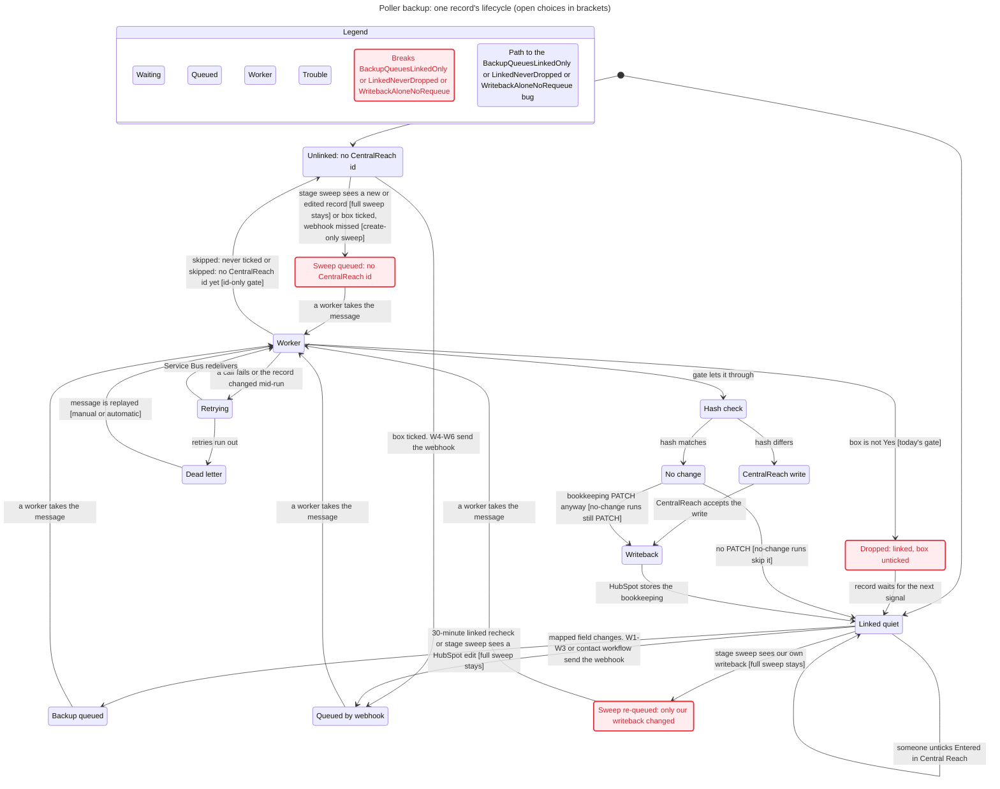

# Poller backup contract

**As of:** 2026-10-29 afternoon. Read from code on `align-sandbox-hubspot-field-sync`. The build target below is settled. It is not coded.  
**Portal:** sandbox `50850427`. Do not write production `50317927`.  
**Timer:** still off on the Function App. Do not enable `intakePoller` until Zeke asks. Leave CentralReach metadata `132304` alone while it still holds the `POLL1` leftover.

The webhook is the fast path. The poller is the backup for a change a HubSpot workflow did not send. Most records now arrive by webhook, so each tick has to stay cheap.

Related matrix rows: G2, G7, and G9 in [`ws2-coverage-matrix.md`](ws2-coverage-matrix.md).

---

## Direction (Zeke, 10/29)

- **Event-first.** HubSpot workflows calling the webhook are the main path.
- **Going fully event-based is not an Azure rewrite.** The webhook receiver and queues already exist. What is missing is proof that the workflows send a signal for every mapped change. Until that proof exists, the poller stays as the backup. Phase it out later if monitoring shows it catches nothing.
- **The poller must make far fewer HubSpot calls.** Target interval is 30 minutes, with sound retry logic and the Drive section 2 API rules applied.
- **The build target is settled.** The next session implements it. The timer stays off until Zeke asks.

---

## Four cases

| Case | Path | Notes |
| --- | --- | --- |
| Case Status (`case_status`) | **poller** | A stored write moves `hs_lastmodifieddate`. The sweep can enqueue when the deal is on the stage allowlist and inside the lookback. Linked recheck covers a linked Case the sweep missed. After enqueue, Warm adds Active and Cold adds Inactive. In Limbo adds neither. W1 also watches this property. |
| Staffing Status (`staffing_status`) | **poller** | Same notice path as Case Status. The worker fetches the property and no mapper reads it, so CentralReach does not change. A webhook on this property hits the same gap. |
| BCBA and BT name rollups | **workflow (fast), linked recheck (slow)** | Production triggers are calculated. Danny (10/28) says production workflows already trigger on these name fields. Whether a calculated refresh moves `hs_lastmodifieddate` is unproven, so the sweep is not a proven notice. Linked recheck does not use that timestamp. It re-reads every linked Case, and the client hash includes metadata, so it catches a rollup change on its next pass over that Case. Sandbox W1 does not watch these fields yet (G9). |
| IA BCBA, RE BCBA, and BT associations | **poller** | Linked recheck re-reads Cases that already have `client_id_number`. The client worker then hashes association type ids that are outside the exclusion set, including sandbox 163, 161, 149, and 147. The sweep cannot see an association-only edit. HubSpot workflows cannot enroll on the label. The name-field triggers above are the workflow signal for most staffing changes. |

### Name rollups after enqueue

The worker reads `reassessment_bcba_name`, `current_primary_bt`, `current_primary_bt_2`, `initial_assessment_bcba`, and `supervising_bcba`. It does not read `ia_bcba_name` or `supervising_bcba_name`.

- IA name written to CentralReach comes from `initial_assessment_bcba`.
- Supervising name comes from the billing text field, then `supervising_bcba`.
- A workflow that fires on `ia_bcba_name` queues the Case and does not send that name.

### Associations after enqueue

`SANDBOX_STAFFING_ASSOCIATION_TYPE_IDS` is not imported by any file under `src/`. Comparison keeps every type id that is not in `STAFFING_ASSOCIATION_TYPE_IDS_EXCLUDED`. CentralReach display names still come from the Case rollup properties above. Association changes on a BT/RBT or BCBA employee record are not in the employee hash.

### Worker gate

Zeke (10/29) and the Drive spec agree. "Entered in CR" is not the gate after the first push, because records can show unchecked later. Danny (10/28) says a known CentralReach id is the gate for ongoing updates. The workers still skip any record whose checkbox does not contain `Yes` (`enterInCentralReachContainsYes` in `clientSyncWorkflow.mjs`, and the matching check in `employeeSyncWorkflow.mjs`). So linked recheck can enqueue a linked record that the worker then drops. The build target gate is "CentralReach id or box Yes" on both workers. Code comments in both files still wait on Sara for never-ticked linked records, and the employee file still leaves "Yes - Generic" and "No- Made Inactive" open. The first live pass is a sandbox dry run. Do not turn dry run off until that would-write list is reviewed.

---

## Timer (today)

| Item | Value |
| --- | --- |
| Schedule | `0 */5 * * * *` in `src/functions/intakePoller.mjs` (every five minutes) |
| Sweep | Cases, BT/RBT, and BCBA on the pipeline and stage allowlists, with `hs_lastmodifieddate` inside the lookback. Code default lookback is 15 minutes when `LOOKBACK_MINUTES` is unset. Deployed value was not re-read in this pass. |
| Linked recheck | Same tick, after the sweep. One page per object of records that already have a CentralReach id. No stage filter. No timestamp filter. Every record on the page is enqueued. Cursor is saved across ticks and wraps to the start after the last page. |
| Page size | At most 50 results per search. Default `MAX_SEARCH_REQUESTS_PER_SECTION` is 1. |

### What a tick skips

The sweep enqueues only when `hs_lastmodifieddate` is strictly newer than `integration_last_write`, and only when this poller has not already enqueued that same timestamp on `dedupe:client-sync` or `dedupe:employee-sync`.

The webhook coalesce key is a different partition, `dedupe:hubspot-webhook`. The tick does not read `last_sync_hash`. The queue worker compares that hash after enqueue. A match skips the CentralReach write and still patches HubSpot bookkeeping, including `integration_last_write`. Linked recheck does not use the timestamp skip.

### Sweep re-enqueue loop (code read, not proven at runtime)

Both workers set `integration_last_write` from the Azure clock, then send the writeback PATCH. HubSpot stamps `hs_lastmodifieddate` when it applies that PATCH, a moment later. On the next tick the sweep sees the record as modified after the last write. The dedupe key carries the new timestamp, so it does not block. The worker runs, matches the hash, and patches bookkeeping again. An allowlisted record that synced in the last 15 minutes can re-enqueue on every tick.

The 10/29 poller test logged one more `noop` client sync at 14:15 after the restore. That is consistent with this loop. It does not prove it.

---

## Cost

### Searches per tick

A successful leased tick with recheck on is **6 HubSpot searches** (3 sweep + 3 recheck). If HubSpot rejects the lookback on all three sweep searches, the fallback makes it **9**. A held lease makes no HubSpot call. A failed Case search returns before the other searches and before recheck.

### Worker calls per enqueue

Searches are the small part. Each enqueue runs a worker, and the worker reads HubSpot again even when nothing changed.

| Worker | HubSpot calls per run, read from code |
| --- | --- |
| Client | 3 deal GETs (initial, immediate re-read, confirm), 1 contact association list, 1 GET per Parent/Guardian contact, 2 staffing association lists, 1 writeback PATCH. At least 8. |
| Employee | On a real change: 3 record GETs (initial, immediate re-read, confirm) and 1 writeback PATCH. A hash match skips the confirm GET, so that run is 2 GETs and 1 PATCH. Plus 1 CentralReach GET when the record is linked. |

Linked recheck with full pages enqueues 50 Cases, 50 BT/RBT, and 50 BCBA. Counting the change-path employee reads, that is about 3 + 400 + 400, so roughly **800 HubSpot calls per tick**. A tick where every employee is unchanged is closer to **700**, because those runs skip the confirm GET. Client runs still do the confirm read on a hash match.

| Interval | Ticks per day | HubSpot calls per day, full recheck pages |
| --- | --- | --- |
| 5 minutes (today) | 288 | about 231,000 |
| 30 minutes (target) | 48 | about 38,500 |

A full recheck pass over the 429 production Cases with a CentralReach id (Drive count, Oct 22) takes 9 ticks. That is 45 minutes at 5 minutes and 4.5 hours at 30 minutes. Sandbox has few linked records, so a sandbox tick costs much less. Production linked BT/RBT and BCBA counts were not read.

Unproven in this pass: whether a calculated refresh or an association edit moves `hs_lastmodifieddate`; the live deployed values of `LOOKBACK_MINUTES`, `MAX_SEARCH_REQUESTS_PER_SECTION`, and `LINKED_RECHECK_ENABLED`; the production linked record counts.

---

## HubSpot limits

Checked 10/29 with HubSpot CLI `fetch-doc` on [API usage guidelines and limits](https://developers.hubspot.com/docs/developer-tooling/platform/usage-guidelines), [CRM Search API](https://developers.hubspot.com/docs/api-reference/latest/crm/search-the-crm), and [Associate records](https://developers.hubspot.com/docs/api-reference/latest/crm/associations/associate-records/guide).

- **Private app burst:** 190 requests per 10 seconds per app on Professional and Enterprise.
- **Daily:** 625,000 (Professional) or 1,000,000 (Enterprise) per account. The daily pool is shared by every app in the account.
- **CRM search:** 5 requests per second per account. Up to 200 results per page. Search responses carry no rate-limit headers.
- **Associations API:** 150 requests per 10 seconds on Professional and Enterprise. Batch read accepts up to 1,000 inputs.
- **429 responses** name the limit in `policyName` (`DAILY` or `TEN_SECONDLY_ROLLING`). The daily limit resets at midnight in the account time zone.
- **Error rate:** error responses should stay under 5% of daily requests.

### Retry today

`src/lib/retry.mjs` retries 429 and 5xx up to 3 attempts. It honors `Retry-After` up to 5 seconds, otherwise 400 ms doubling. It does not read `policyName`, so a daily-limit 429 is retried like a burst 429. `host.json` sets no Service Bus concurrency, so the worker fan-out after a recheck runs at the host default.

The webhook returns HTTP 500 when the enqueue fails, so HubSpot retries that delivery. HubSpot does not retry other 4xx responses, and it stops after three days.

---

## Drive section 2 API rules that touch the poller

| Rule | What it means here |
| --- | --- |
| 1. Use your own private app token | Done. The burst limit is ours alone. The daily pool is still shared with United Care's other apps. |
| 2. Sensitive fields are silently omitted without the scope | A value missing from a read is not a blank. Never turn it into a CentralReach clear. The Drive hybrid section says the same for a 403. |
| 4. Calculated and synced fields reject writes | The writeback must never include a rollup or synced field. Today it writes integration fields only. |
| 5. Staffing is associations | Read with the v4 associations API, which has its own lower burst limit. |
| 11. A missing property breaks the whole write | One renamed writeback property fails the whole PATCH. Give Danny the writeback property list so it is protected. |

---

## Build target (settled 10/29 afternoon)

Not coded. The timer stays off. Sandbox portal `50850427` is the only portal for the first pass. Do not write production `50317927`.

```text
HubSpot workflows (fast path)
  W4-W6   create signal when Entered in CR is ticked
  W1-W3   ongoing signals, plus the five staffing name fields on W1 (Danny 10/28)
  Contact ongoing workflow (decided 10/28)
        |
        |  ID-only webhook. 500 on enqueue failure, so HubSpot retries.
        v
  Service Bus  ->  workers  ->  CentralReach
        ^
        |  linked recheck: CentralReach id known, any stage
        |  never-processed sweep: box Yes, no id, no last_sync_at, older than 10 minutes
  intakePoller every 30 minutes (backup, timer off until Zeke asks)
```

1. **Replace the stage-allowlist sweep with a never-processed sweep.** Drop the stage allowlist and the lookback sweep. They queue unlinked records and they re-enqueue after writeback. The replacement queues a record only when all four are true. The checkbox contains `Yes`. The CentralReach id is empty. `last_sync_at` is empty. `hs_lastmodifieddate` is older than 10 minutes (`CREATE_SWEEP_GRACE_MINUTES`, default 10). `CREATE_SWEEP_ENABLED` defaults to false. A record with no `last_sync_at` is one Azure never processed, which is a create webhook that never arrived. Unticked records stay out. While the timer is off, the sweep does not run. A HubSpot list with the same four filters shows those records. The list does not create the CentralReach client.
2. **Ship the error writeback before the never-processed sweep.** Until failures write `last_sync_at`, a failed employee create, and a client that dies on `SYNC_IN_PROGRESS` or `SYNC_STALE`, stay empty. The new sweep would queue them every tick.
3. **Run the timer every 30 minutes** (`0 */30 * * * *`) only after Zeke asks. It is off now.
4. **Gate the workers on "CentralReach id or box Yes."** One predicate on the client worker and the employee worker. "CentralReach id only" on this same worker blocks every first create, because W4–W6 queue the record before it has an id. The checkbox stays the create signal.
5. **Skip the bookkeeping PATCH when the hash matches.** A real CentralReach write, and a run that changes `last_sync_hash`, still PATCH. A no-change recheck does not move `integration_last_write`. The 24-hour report then counts payload changes. If that report is a visit heartbeat, keep the PATCH instead. That reversal is the one report choice still available.
6. **Retry by limit type.** End the tick on a `DAILY` 429. Back off on a burst 429. Keep searches under 5 per second. Not coded. The delayed recovery below does not special-case a daily 429, which lasts until midnight.
7. **Write HubSpot on the final Service Bus delivery.** `last_sync_status` becomes `error` and `last_sync_at` is set, including for `SYNC_IN_PROGRESS` and `SYNC_STALE`. Earlier attempts still rethrow, so a lock that clears on retry does not stamp an error. The employee catch today writes Cosmos and does not write HubSpot, except a metadata failure. Give it the same error writeback the client worker has. Reuse the value `error`. A new dropdown value fails the whole PATCH. A HubSpot list on `last_sync_status` is `error` shows the record.
8. **Recover a dead-lettered linked record twice, then stop.** Schedule one new message 30 minutes later and one 2 hours later. The original message still dead-letters. First creates stay manual. This does not add searches. The recheck cursor remains the slow net.
9. **Dry-run the first pass.** `SYNC_DRY_RUN` defaults to false. When it is on, both workers stop after the hash compare and log who would write. They do not call CentralReach upsert or the HubSpot writeback. The employee worker still reads CentralReach for a linked record. The published sandbox app already wrote CentralReach client `5324526` on deal `66712883229` during the 10/29 webhook proof. A live sandbox pass writes the CentralReach id stored on the record. Confirm each id is a test client before dry run is turned off.
10. **Phase the linked recheck out only after evidence.** The never-processed sweep stays once the backup is on. It is three searches a tick and it guards creates. Linked recheck stays while an association-only staffing edit has no workflow. Workflows cannot enroll on the label. Linked recheck can become sandbox-only after a production stretch with zero recheck successes, and after Danny confirms that association edits always arrive with a name rollup W1 watches. Thirty quiet days is the bar. It is not a measured result. Store `source` on the Cosmos success record. `host.json` samples non-request telemetry, so do not count this from App Insights traces.

### Still open

- Recheck page size, and the full-pass time you accept. The cost section still uses 50 records per search. At that size, 429 production Cases take 4.5 hours at 30 minutes.
- Before any production tick, count records that are ticked, have no CentralReach id, and have no `last_sync_at`. Hand-entered clients in that set would be created on the first production tick.
- Whether CentralReach client `5324526` is a safe live sandbox record. The dry-run list has to say so before anyone turns dry run off.

---

## Record lifecycle (checked 10/29)

One record (Case, BT/RBT, or BCBA) was modeled in TLA+ from the code on this branch and checked with TLC against the five rules below. Each break was then replayed against the real worker and poller functions with HubSpot, CentralReach, Cosmos, and Service Bus stubbed. Open choices appear as arrows with the option in brackets. The chart shows every option at once and decides none of them. Red states break a rule.



The chart does not draw a failed CentralReach write or a failed writeback (both go to Retrying, like a failed worker read). It also leaves out the arrows from Dead letter to the linked recheck and to a create-only sweep. Those steps are in the check.

### Rules

1. **A linked record is never dropped.** A known CentralReach id is the ongoing gate. "Entered in Central Reach" is only the first-push signal, so a box unticked later must not stop updates.
2. **The backup poller queues only records that already have a CentralReach id.** It does not pick up a first-time create. The 10/29 afternoon build target restates this. The never-processed sweep also queues a ticked record that has no CentralReach id and no `last_sync_at`. Unticked records stay out.
3. **A hash match does not write CentralReach.**
4. **A bookkeeping writeback does not by itself cause another CentralReach write.**
5. **An unlinked record that was never ticked is not synced.**

### Where today's code breaks a rule

| Rule | Chart state | How it happens | Confirmed in |
| --- | --- | --- | --- |
| 1 | Dropped: linked, box unticked | A linked record is unticked. A W1–W3 webhook or the linked recheck queues it. The worker gate returns `skipped` with no CentralReach write and no HubSpot PATCH. The recheck selects it again on every pass, so it is read and dropped again each time. | `clientSyncWorkflow.mjs` (`enterInCentralReachContainsYes`), `employeeSyncWorkflow.mjs` (`enteredInCentralReachContainsYes`) |
| 2 | Sweep queued: no CentralReach id | The stage sweep search has no CentralReach id filter, and `shouldSyncDeal` returns true when `integration_last_write` is empty. Any new record on an allowlisted stage inside the lookback is queued. | `intakePollerWorkflow.mjs`, `searchIntakeCompleteDeals` in `hubspotClient.mjs` |

Rules 3, 4, and 5 hold in today's code. The model with the sweep dropped and a gate of "CentralReach id or box Yes" holds all five rules.

**The re-enqueue loop does not break rule 4.** After a writeback, the sweep queues the record again. The hash matches, CentralReach is not written, and bookkeeping is patched again, which sets up the next re-queue. The loop costs a full worker run on every tick. It never writes CentralReach. The chart marks it as "Sweep re-queued: only our writeback changed", using a check that is not one of the five rules: a bookkeeping writeback does not by itself queue the record again. The replay confirms every step in code. The one unproven step is still that HubSpot stamps `hs_lastmodifieddate` after the Azure clock sets `integration_last_write`.

### What the check shows about the open questions

The check did not decide these. The build target above is the 10/29 afternoon decision. The notes here are what the check showed.

- **Question 1 (sweep).** Dropping the full sweep removes both the rule 2 break and the loop. A create-only sweep breaks rule 2 by design, so keeping one means restating rule 2. With no sweep, a ticked record whose create webhook never lands stays out of CentralReach. Neither the dead-letter count nor webhook 400 and 401 responses show it, because Azure never receives anything for that record. Today the full sweep does catch that case for a record on an allowlisted stage inside the lookback.
- **Question 3 (no-change PATCH).** While the full sweep stays, skipping the no-change PATCH does not stop the loop. The writeback after a real write still re-queues the record once. With the sweep dropped, the no-change PATCH re-queues nothing. It only costs a PATCH and decides what the 24-hour report counts.
- **Question 4 (gate).** "CentralReach id only", applied to the one worker that also handles creates, blocks every first-time create, because W4–W6 queue a record before it has an id. TLC found no path to a create under that gate. "CentralReach id or box Yes" holds all five rules. If "id only" is chosen, the create path needs its own gate.
- **Question 6 (replay).** A dead-lettered linked record is queued again by the next linked recheck either way. A dead-lettered first-time create comes back only by replay, or by a create-only sweep if one is kept.
- Questions 2 and 5 are not record states, so the model leaves them out.

### What the model leaves out

One record at a time, so no concurrent or duplicate messages and no per-record lock contention. The record is assumed to sit on an allowlisted stage, and the lookback window is not modeled. A change no workflow sends is modeled as an association or rollup change that the sweep cannot see. The hash is assumed to differ exactly when a mapped field changed, so a mapping-version change, the association-read fallback, and CentralReach-side drift such as the `POLL1` leftover in metadata `132304` are out. A hash match does not repair CentralReach drift.

---

## Gates that still hold

- Do not enable `intakePoller` until Zeke asks.
- Do not merge until the WS.2 proof exists.
- Do not write production portal `50317927`.
- Leave CentralReach metadata `132304` alone while it still has `POLL1`.
