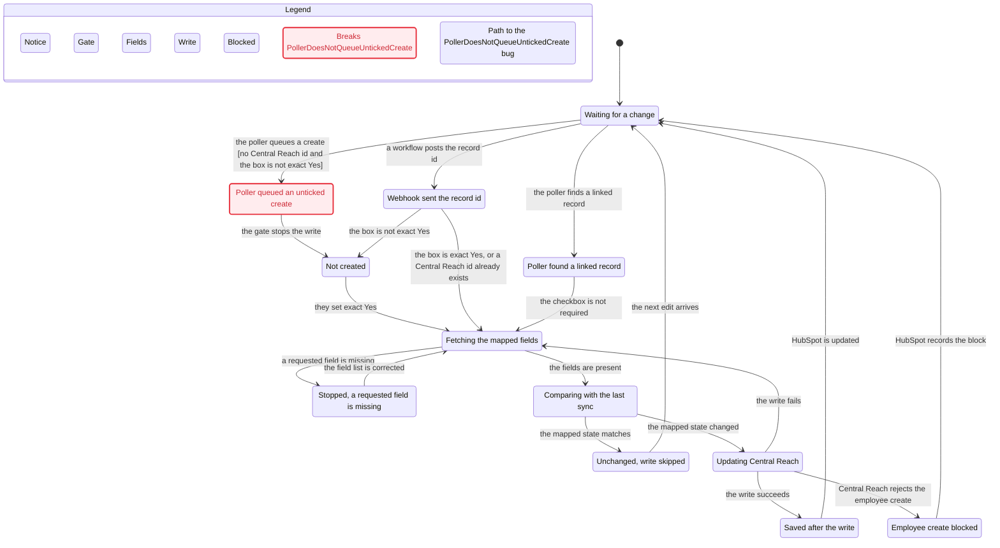

# Session log 1d5f2511
User-visible turns from transcript `1d5f2511-1179-48ac-87a9-48198d708626`, in order.
Tool-call arguments and raw tool results are omitted. Inlined skill text and the system tool catalog are omitted. A tool-fact sentence is added only where a tool result changed the next step. That sentence uses a branch, commit, file, or portal id already stated in the chat.

## Turn 1 — User
*Transcript line 1. Friday, Oct 30, 2026, 6:32 AM (UTC-5)*
*Inlined skill text omitted: poteto-mode, statechart.*

10/30 Finalizing the documentation and state chart

We need to finalize the actual integration flow and state chart. Now, if it suffices just to have the state chart and remove the integration diagram for now, we will do that.

We have the advantage of referencing actual logs from the previous build and testing and problems ran into. 
 and our open question items on This includes our open question items on what needs to be updated, brought over from our previous Azure build and included here

I think, really truly, reviewing all the open-ended questions that we've received, reviewing the previous "more than how they were" and what previous files and the issues they caused, what they caused are current clean files.

docs/workstreams/repository-review-confirm-and-update/. These five files from this chat are in it.

The open questions on what should be brought over from the previous repo to here are here.
clean-tree-recovery-review.md
judge-intake-path.md
judge-field-mappings.md
judge-docs-on-main.md
judge-handoff-inventory.md
docs/Azure_repo_recovery_handoff.md 

~/Desktop/projects/client_projects/Optidge/azure_central_reach/docs/workstreams/repository-review-confirm-and-update
Let's generate 

State diagram and I'm happy to have that double as an integration flow as well, as long as we're including the webhook in the poller in the fields' stages that are involved.

Current state diagram

Hybrid Change Detection — MVP
Lucid
https://docs.google.com/document/d/1TnUrUUUWuTQv9hLOaZdmM9YD9va2eKXIoAtw_puiYyk/edit?tab=t.yjiornmys9tz#heading=h.hsrhb1byl61j

We have the advantage of referencing actual logs from the previous build and our open question items on how on the open, what should be brought over from our previous build and included or added to our previous build? You can see from comparing the previous to the current clean what is being suggested. To add that, blocked the end-to-end testing, caused hurdles, and messed up any of the fields
the open questions are all in this folder 
~/Desktop/projects/client_projects/Optidge/azure_central_reach/docs/workstreams/repository-review-confirm-and-update

use your best judgment on the models and workstreams to use on this. I think it would be helpful to have:
- one that builds the state chart
- one that reviews the past implementations
- one that reviews the open questions From the open questions, the reviewer reviews the past implementations, what was blocked, etc. Then we go through and build our state chart based on our fields that should be included to help with the state, the webhook trigger, and the polling. Please run this prompt as you need to. Please proceed

You can also reference previous archive chats and see what state was produced there as the state chart.

~/Desktop/projects/client_projects/Optidge/azure_central_reach/docs/workstreams/state chart and mapping

/poteto-mode  
/statechart 

and if there is another skill that will help us build this out, please do. The leading intent is to use open questions: what was actually solved and happened, and then build the state with an explanation of the open questions, what should be brought over, and what shouldn't. After that, we can, I think, start doing testing here, so please proceed.

## Turn 2 — Assistant
*Transcript line 2.*

The goal is a single integration state chart for the Central Reach sync, grounded in what the previous Azure build actually did, what blocked testing, and which open questions still change the flow. The smallest useful result is that chart plus a short bring-over decision, so testing can start from one agreed path. I’ll load the playbook and the review notes, then split the past-build review, the open questions, and the chart itself.

## Turn 3 — Assistant
*Transcript line 9.*

The reviews have to land before the chart. Otherwise the states would be a guess. I’m starting three code traces and four history searches in parallel. The chart comes after they agree on the webhook, the poller, and the field stages.

Configured model names from the local role file are not in this session’s list, so these traces run on Grok 4.7. The later write-up will use Claude Opus. Real-time chat, live infrastructure logs, error tracking, and product analytics have no connected source here, so those searches are gaps.

## Turn 4 — Assistant
*Transcript line 10.*

The goal is one state chart that is also the HubSpot to Central Reach flow. It has to include the webhook, the intake poller, and the field stages, and it has to say what comes over from the previous Azure build.

A second integration diagram is not part of this pass. You already said the chart can stand in for that diagram.

**Guard the Context Window.** The five judge files, the recovery handoff, and the archive stay with the reviewers. This chat keeps a short status note at `docs/workstreams/integration-state-chart/STATE.md`.

**Foundational Thinking.** The chart waits until those reviews name the real stages. Writing the spec from the Google Doc title alone would invent states.

**Model the Domain.** The flow is one state machine. Webhook intake, poller ticks, queue work, mapping, and Central Reach writes are states in that machine.

**Never Block on the Human.** I took your offer to drop the separate integration diagram and started the reviews.

Three code traces are running.

- [Current intake path](5da7c42f-c596-4b24-8b53-723f0746c982) is reading the clean webhook, poller, queues, and field stages.
- [Open-question judges](6d6a42e0-807c-4f94-9e11-876e0ed2da67) is reading the five files in `docs/workstreams/repository-review-confirm-and-update/` plus the recovery handoff.
- [Previous Azure build](8e6119c7-8e11-4934-a0ec-559a5dfcb581) is comparing the 2026-10-30 archive with the clean tree, including earlier charts and the failures that blocked testing.

Four history searches are running beside those traces. [Git history](fea5a466-73f3-403b-aa0c-3e1bb123f8dc) covers the hybrid change-detection commits and pull request 1. [Asana](52a8d3f2-ee1d-4ab7-8a07-58f523695020), the [Google Doc](d808b3bb-1f32-49f5-9f4f-5f971c0c4b21) you linked, and [Notion](495ea5de-b430-4282-9c8c-72b73577223a) cover the written decisions. Team chat, live Azure logs, error tracking, and product analytics are not connected, so those sources are gaps.

The folder `docs/workstreams/state chart and mapping` is not in this repo. The archive review is looking for the earlier chart there and in prior chats.

The role file names models this session cannot start. The traces are on Grok 4.7. The write-up after they return will use Claude Opus.

throughput checkpoint: n/a, read-only investigation.

When the reports are back I will reconcile them and generate the chart from a checked spec. Testing stays for the pass after that.

## Turn 5 — User
*Transcript line 11. Friday, Oct 30, 2026, 6:36 AM (UTC-5)*

Perform any necessary follow-up actions in response to the subagent completion above. If no follow-up work is needed, no further action is required. If you mention an agent or subagent in your response, link it with the `[Name](id)` Don't use generic label such as `[agent]`, `[worker]`, or `[subagent]`. For cloud subagents, when the agent has edited code, link to `[Review](bc-id#changes)`, or, if you know the exact added and deleted line counts, `[Review +A −D](bc-id#changes)`, replacing A and D with those counts. Never write A or D literally. Use `[Try Live](bc-id#desktop)` only when the agent used computer use. Don't repeat the same confirmation every time.

## Turn 6 — Assistant
*Transcript line 13.*

[Asana](52a8d3f2-ee1d-4ab7-8a07-58f523695020) stopped before any search. The Asana connection asked for sign-in, and that sign-in was skipped, so there are no ticket titles or comments to use. I am not guessing what those tickets say.

The chart will use the repo history, the judge files, the archive, the Google Doc, and Notion. If you connect Asana later, those tickets can be added. The other six reviews are still running.

Tool fact: the Asana connection asked for sign-in, that sign-in was skipped, and no ticket titles or comments were returned.

## Turn 7 — User
*Transcript line 14. Friday, Oct 30, 2026, 6:38 AM (UTC-5)*

Perform any necessary follow-up actions in response to the subagent completion above. If no follow-up work is needed, no further action is required. If you mention an agent or subagent in your response, link it with the `[Name](id)` Don't use generic label such as `[agent]`, `[worker]`, or `[subagent]`. For cloud subagents, when the agent has edited code, link to `[Review](bc-id#changes)`, or, if you know the exact added and deleted line counts, `[Review +A −D](bc-id#changes)`, replacing A and D with those counts. Never write A or D literally. Use `[Try Live](bc-id#desktop)` only when the agent used computer use. Don't repeat the same confirmation every time.

## Turn 8 — Assistant
*Transcript line 17.*

[Current intake path](5da7c42f-c596-4b24-8b53-723f0746c982) finished the clean-tree trace. The chart will not draw the webhook, the poller, and linked recheck as steps in a line. They are three doors into one queue. After that, the worker maps the fields, then writes Central Reach, skips an unchanged hash, blocks a new employee, or fails and retries. Only the poller waits for a newer HubSpot edit. The webhook and linked recheck do not.

The other five reviews are still out. The spec waits for them.

Tool fact: the clean-tree intake trace showed the webhook, the poller, and linked recheck are not steps in one line, so the chart will not draw them that way.

## Turn 9 — User
*Transcript line 18. Friday, Oct 30, 2026, 6:39 AM (UTC-5)*

Perform any necessary follow-up actions in response to the subagent completion above. If no follow-up work is needed, no further action is required. If you mention an agent or subagent in your response, link it with the `[Name](id)` Don't use generic label such as `[agent]`, `[worker]`, or `[subagent]`. For cloud subagents, when the agent has edited code, link to `[Review](bc-id#changes)`, or, if you know the exact added and deleted line counts, `[Review +A −D](bc-id#changes)`, replacing A and D with those counts. Never write A or D literally. Use `[Try Live](bc-id#desktop)` only when the agent used computer use. Don't repeat the same confirmation every time.

## Turn 10 — Assistant
*Transcript line 19.*

The open-question review is in. I’ll record the bring-over list and the one disagreement that still changes the chart, and leave the spec until the archive and the written diagrams come back.

## Turn 11 — User
*Transcript line 20. Friday, Oct 30, 2026, 6:39 AM (UTC-5)*

Use these 

The chart will use the repo history, the judge files, the archive, the Google Doc sorhce of truth. 

You woul need to review trhe old azure repo.

## Turn 12 — Assistant
*Transcript line 21.*

The chart sources are the repo history, the judge files, the archive, and the Google Doc. I’ll confirm which checkout is the old Azure repo and drop Notion and Asana from this pass.

## Turn 13 — User
*Transcript line 23. Friday, Oct 30, 2026, 6:40 AM (UTC-5)*

this repo azure_central_reach_recovery

## Turn 14 — Assistant
*Transcript line 24.*

The old build to review is `azure_central_reach_recovery`, not the backup folder. I’ll find that checkout and read it against the same webhook, poller, and field stages.

## Turn 15 — Assistant
*Transcript line 35.*

`azure_central_reach_recovery` is not a checkout I can open. It is not under the Optidge project folder, and GitHub has no repository by that name under Optidge or ezekielswanson. A recovery review earlier today already looked for that folder and for a `recovery/clean-baseline` ref, and neither existed.

The previous Azure build that is on disk is the archive at `/Users/zeke/Desktop/projects/client_projects/Optidge/azure_central_reach_backup_2026-10-30`. That checkout is on `align-sandbox-hubspot-field-sync` at `a8e3be7`. [Previous Azure build](8e6119c7-8e11-4934-a0ec-559a5dfcb581) is already reading it.

The chart sources stay the fresh repo history, the five judge files, that archive, and the Google Doc as the business source of truth. Notion and Asana are out.

If `azure_central_reach_recovery` lives at a different path or under a different GitHub owner, send that path and I will review that tree instead of the backup.

Tool fact: `azure_central_reach_recovery` is not a checkout under the Optidge project folder, and GitHub has no repository by that name under Optidge or ezekielswanson.

## Turn 16 — User
*Transcript line 36. Friday, Oct 30, 2026, 6:42 AM (UTC-5)*

No user query text. The message was only a timestamp.

## Turn 17 — User
*Transcript line 37. Friday, Oct 30, 2026, 6:42 AM (UTC-5)*

No user query text. The message was only a timestamp.

## Turn 18 — User
*Transcript line 38. Friday, Oct 30, 2026, 6:42 AM (UTC-5)*

No user query text. The message was only a timestamp.

## Turn 19 — User
*Transcript line 39. Friday, Oct 30, 2026, 6:42 AM (UTC-5)*

Perform any necessary follow-up actions in response to the subagent completion above. If no follow-up work is needed, no further action is required. If you mention an agent or subagent in your response, link it with the `[Name](id)` Don't use generic label such as `[agent]`, `[worker]`, or `[subagent]`. For cloud subagents, when the agent has edited code, link to `[Review](bc-id#changes)`, or, if you know the exact added and deleted line counts, `[Review +A −D](bc-id#changes)`, replacing A and D with those counts. Never write A or D literally. Use `[Try Live](bc-id#desktop)` only when the agent used computer use. Don't repeat the same confirmation every time.

## Turn 20 — Assistant
*Transcript line 40.*

The archive review and the git history are in. The earlier poller chart is not the flow to keep. I’ll record that and write the explanation from the three code traces. The spec still waits on the Google Doc, which is the business source of truth.

## Turn 21 — Assistant
*Transcript line 42.*

The previous build is the archive checkout, not a repo named `azure_central_reach_recovery`. [Previous Azure build](8e6119c7-8e11-4934-a0ec-559a5dfcb581) and [Git history](fea5a466-73f3-403b-aa0c-3e1bb123f8dc) agree on what that archive actually did.

**Model the Domain.** The new chart is the hybrid path. A HubSpot workflow posts the record id. The five-minute poller is the backup. Linked recheck covers records that already have a Central Reach id. One worker then fetches fields, stops if a requested property is missing, maps, compares the hash, writes Central Reach, adds labels, and writes HubSpot back. The exact-Yes or already-linked gate is on that chart even though the fresh code does not read the checkbox yet.

The earlier diagram stays behind. It is the poller lifecycle in the archive file `docs/poller-backup-contract.md`. That chart's broken paths are an unlinked create sweep, dropping a linked record whose box is unticked, and queueing again because our own writeback changed the record. Those are the redesign commits the handoff says not to copy.

Three sandbox failures are the reason for the small bring-over list. All-digit dates became null, so employee create returned HTTP 400 and the worker marked the record blocked with no retry. The published app required the box to stay Yes, so an uncheck could not update a linked record. Asking HubSpot for BT/RBT `postal_code`, which exists on neither portal, made every BT/RBT fail before a Central Reach call. The date parser is still only an uncommitted edit in the archive.

`testing_azure_central_reach`, `aws_central_reach`, and `central_reach_app` are other products. They are not this Functions app.

[Integration flow](2439f36d-c6aa-45cd-8af1-99ca046f2db2) is writing that up now. The spec waits for the Google Doc, because that doc is the business source of truth for the field stages. Notion came back and matches this shape, and it is not the authority for the chart.

Tool fact: the previous build used for the chart is the archive checkout, not a repository named `azure_central_reach_recovery`.

## Turn 22 — User
*Transcript line 43. Friday, Oct 30, 2026, 6:43 AM (UTC-5)*

Perform any necessary follow-up actions in response to the subagent completion above. If no follow-up work is needed, no further action is required. If you mention an agent or subagent in your response, link it with the `[Name](id)` Don't use generic label such as `[agent]`, `[worker]`, or `[subagent]`. For cloud subagents, when the agent has edited code, link to `[Review](bc-id#changes)`, or, if you know the exact added and deleted line counts, `[Review +A −D](bc-id#changes)`, replacing A and D with those counts. Never write A or D literally. Use `[Try Live](bc-id#desktop)` only when the agent used computer use. Don't repeat the same confirmation every time.

## Turn 23 — Assistant
*Transcript line 47.*

The Google Doc is the business flow: an ID-only webhook and a linked-record poller join one compare, then either update Central Reach or skip the write. I’m adding the field stages and the create gate that the drawing leaves out, and generating the chart from that.

## Turn 24 — Assistant
*Transcript line 55.*

The goal is one chart you can test against. It is the HubSpot to Central Reach flow, with the webhook, the poller, and the field stages on the same picture.

**Model the Domain.** The Google Doc's hybrid drawing is the spine. A workflow posts the record id, or the poller finds a record that already has a Central Reach id. Both doors meet at one compare. A changed record updates Central Reach. An unchanged record skips the write. The create gate and the missing-field stop are states on that same machine. A second integration diagram is not part of this pass.

**Foundational Thinking.** Each step tracks four facts. Where the record is in the flow, whether a Central Reach id is known, whether the checkbox is exact Yes, and whether the field read succeeded.

[Google Doc](d808b3bb-1f32-49f5-9f4f-5f971c0c4b21) read the V2 guide, heading Hybrid Change Detection, MVP. That drawing has the two doors and the compare. It names no pipeline stage, no queue, and no field stop. The same guide's sandbox section says six workflows are already enabled, while the hybrid section says those workflows were not created. The chart uses the two-door flow. The create gate from the guide's earlier section is on it, because a record with no Central Reach id is created only when the box is exact Yes. `Yes - Generic` does not count. Once an id exists, clearing the box does not stop updates.



The red state is the only rule that breaks. The rule is `PollerDoesNotQueueUntickedCreate`. In reader words, the poller does not queue a create when there is no Central Reach id and the box is not exact Yes. The shortest path is one step. Waiting for a change, then the poller queues that create. Waiting is marked only because that step starts there. The gate arrow is the bring-over that stops the write.

That path matches the fresh code. `shouldSyncDeal` returns true when `integration_last_write` is empty. It never reads the entry checkbox. I did not run the poller. A live tick can create a production Central Reach record.

```40:52:src/workflows/intakePollerWorkflow.mjs
export function shouldSyncDeal(candidate) {
  const properties = candidate?.properties || {};
  const hsLastModifiedDate = parseTimestamp(properties.hs_lastmodifieddate);
  const integrationLastWrite = parseTimestamp(properties.integration_last_write);

  if (!integrationLastWrite) {
    return true;
  }
  if (!hsLastModifiedDate) {
    return false;
  }

  return hsLastModifiedDate > integrationLastWrite;
}
```

The other rules hold. A write happens only after exact Yes or an existing id. A missing requested field does not continue into the write. A linked record is not classified as "Not created." The saved state exists only after the write succeeds.

**Bring onto the fresh branch before a test run.**

- The date-parser hunk. All-digit HubSpot dates become null today, Central Reach rejects the employee create, and the worker records a block instead of retrying. That block is the yellow state. The parser is still an uncommitted edit in the archive.
- The exact-Yes or already-linked gate, without the rest of the worker redesign.
- The missing-field stop, in the same change as dropping the BT/RBT `postal_code` request and correcting `other_address`. Asking for `postal_code` failed every sandbox BT/RBT before a Central Reach call.
- The webhook routing test only.

**Leave behind.** The archive poller lifecycle in `docs/poller-backup-contract.md` stays a record of the redesign. Its broken paths are an unlinked create sweep, dropping a linked record whose box was unticked, and queueing again because our own writeback changed the record. Also leave `planAttempt`, the create sweep, dry run, label removal, split employee queues, a Workday id, and any poll of portal `50317927`.

The chart hides one step. Clearing the checkbox while a linked record is waiting does not change the visible label. The report counts two hidden steps because that clear can sit on more than one stored combination. The model also leaves out queues, leases, coalesce, the five-minute timer, hash bytes, label ids, which date string Central Reach accepts, the mapping-version bump, and live Function App settings. Those stay open. They do not add a state.

Regenerate with a new output folder.

```sh
/Users/zeke/.cursor/plugins/cache/cursor-public/pstack/1ba91fc25c0977741dd0e267849e6234b037ed0a/skills/statechart/scripts/statechart \
  /tmp/optidge-integration-flow/IntegrationFlow.tla \
  --config /tmp/optidge-integration-flow/IntegrationFlow.cfg \
  --view /tmp/optidge-integration-flow/view.mjs \
  --out /tmp/optidge-integration-flow/out-2
```

TLC checked 30 states. The spec is in `/tmp/optidge-integration-flow`. Testing has not started.

throughput checkpoint: n/a, read-only investigation.

## Turn 25 — User
*Transcript line 56. Friday, Oct 30, 2026, 6:51 AM (UTC-5)*

Perform any necessary follow-up actions in response to the subagent completion above. If no follow-up work is needed, no further action is required. If you mention an agent or subagent in your response, link it with the `[Name](id)` Don't use generic label such as `[agent]`, `[worker]`, or `[subagent]`. For cloud subagents, when the agent has edited code, link to `[Review](bc-id#changes)`, or, if you know the exact added and deleted line counts, `[Review +A −D](bc-id#changes)`, replacing A and D with those counts. Never write A or D literally. Use `[Try Live](bc-id#desktop)` only when the agent used computer use. Don't repeat the same confirmation every time.

## Turn 26 — Assistant
*Transcript line 57.*

The flow write-up landed after the chart, and it flags two code facts the chart may have missed. I’ll check those against the worker before changing the diagram.

## Turn 27 — Assistant
*Transcript line 62.*

[Integration flow](2439f36d-c6aa-45cd-8af1-99ca046f2db2) finished after the chart was already checked. Its write-up still treats the Google Doc as unread, so that list of 24 arrows does not replace the chart. Two code facts from it do change one label.

**Prove It Works.** A client noop skips the Central Reach metadata write and still patches HubSpot. `runClientSyncWorkflow` sets `operation: "noop"` when the hash matches, skips metadata, then calls `pushWriteback` with `last_sync_status: "noop"` and a new `integration_last_write`. The unchanged arrow is now "HubSpot records the skip". The other 18 arrows are unchanged. TLC still reports the same single break, the unticked poller create.

The writeback re-queue is not a new red state. Linked recheck is supposed to enqueue a linked record on a later tick, and the hash compare is what skips the Central Reach write. That loop is already on the chart. The archive's red "sweep re-queued" path is the never-processed sweep, and that sweep is not in this tree.

A second re-queue is possible and unmeasured. The worker puts `new Date()` into `integration_last_write` in the same patch that HubSpot applies. If HubSpot's modified time lands later, `shouldSyncDeal` treats the writeback as a new edit. I have not run that. Waiting stays a normal state until a test shows the extra enqueue.

The deal fetch list does include `postal_code`. The sandbox failure was the BT/RBT object, where that property is absent. Do not treat the deal request as the same stop.

The date parser stays off the chart as its own state. The reader sees it as "Employee create blocked" when Central Reach rejects the create. The parser is still the uncommitted fix to bring over before a test run.

Tool fact: the integration-flow write-up still treated the Google Doc as unread, so its arrow list did not replace the chart.

## Turn 28 — User
*Transcript line 63. Friday, Oct 30, 2026, 7:09 AM (UTC-5)*
*Inlined skill text omitted: poteto-mode.*

/Users/zeke/Desktop/projects/client_projects/Optidge/azure_central_reach/docs/workstreams/integration-state-chart/STATE.md:L38-L55 

I gave my feedback here in the state doc. 

A. reviewer for each of these workers that you spawned. With that, allow an agent or yourself to give it and point it to the most relevant content text to review with. Then turn the open items. Please be sure to kick off these reviewers in @ new task or @A. new thread with fresh context, please.

/poteto-mode

## Turn 29 — User
*Transcript line 64. Friday, Oct 30, 2026, 7:09 AM (UTC-5)*

Stage the changes you worked on, commit, and push for this branch.
- Current branch: review_and_update_code.
- Base branch: main.
- Stage the changes you worked on.
- If there are unrelated files or changes, exclude them.
- Write a concise commit message.
- Push after creating the commit.
- Do not include unrelated files in the commit.

Execute the selected diff-tab commit-and-push action.

## Turn 30 — Assistant
*Transcript line 65.*

You wrote feedback in the state note, and you also want this branch committed and pushed. I’ll read that feedback first, then start a fresh reviewer for each worker and commit only the files that belong to this pass.

## Turn 31 — Assistant
*Transcript line 66.*

Asana is out, and the previous build is the archive checkout. I’ll start a fresh reviewer for each remaining worker, pointed at one source, and commit the state note that is already staged.

## Turn 32 — User
*Transcript line 67. Friday, Oct 30, 2026, 7:12 AM (UTC-5)*

We don't need to commit it to @ push. We can do that after.

## Turn 33 — Assistant
*Transcript line 68.*

I’ll stop the commit and push. Checking whether that command already finished.

## Turn 34 — Assistant
*Transcript line 69.*

The commit and push had already finished before this message. `173ee2f` is on `origin/review_and_update_code`. It adds `docs/workstreams/integration-state-chart/STATE.md` and two empty files in that same folder.

I am leaving that commit where it is. If you want it taken off the remote, say so in a reply. That would rewrite the branch history.

The five fresh reviews are still running. Asana is not one of them. [Google Doc](563abcfe-e010-48d0-a895-f8022fd845ae) is on the tab you linked. [Archive](d3a122c1-89c2-4d81-b8d0-932bab98f4bd) is on the backup checkout. [Judge files](248f8c84-c514-4791-9916-682391edac37), [intake code](b9d0701f-55b7-439c-b4eb-1e7052746512), and [git history](a62c5b34-cc65-4d29-a5dc-5be09061931e) each have the open-item list. I will list what is still open after they report.

Tool fact: commit `173ee2f` was already on `origin/review_and_update_code` before the request to skip the push.

## Turn 35 — User
*Transcript line 70. Friday, Oct 30, 2026, 7:12 AM (UTC-5)*

Briefly inform the user about the task result and perform any follow-up actions (if needed). If there's no follow-ups needed, don't explicitly say that.

## Turn 36 — Assistant
*Transcript line 71.*

The push finished cleanly. `173ee2f` is on `origin/review_and_update_code`. The five open-item reviews are still running.

## Turn 37 — User
*Transcript line 72. Friday, Oct 30, 2026, 7:13 AM (UTC-5)*

Perform any necessary follow-up actions in response to the subagent completion above. If no follow-up work is needed, no further action is required. If you mention an agent or subagent in your response, link it with the `[Name](id)` Don't use generic label such as `[agent]`, `[worker]`, or `[subagent]`. For cloud subagents, when the agent has edited code, link to `[Review](bc-id#changes)`, or, if you know the exact added and deleted line counts, `[Review +A −D](bc-id#changes)`, replacing A and D with those counts. Never write A or D literally. Use `[Try Live](bc-id#desktop)` only when the agent used computer use. Don't repeat the same confirmation every time.

## Turn 38 — Assistant
*Transcript line 73.*

The first tab of the guide settled only a few open items. I’ll record those in the state note and leave the rest until the other four reviews report. Asana stays out, and I won’t commit this.

## Turn 39 — Assistant
*Transcript line 74.*

[Google Doc](563abcfe-e010-48d0-a895-f8022fd845ae) read the first tab of the guide. That tab settles the create gate, the guardian rule, label add and remove, and the HubSpot date format. HubSpot dates are `YYYY-MM-DD` and are written as midnight UTC. Case create is "contains Yes." BCBA and BT/RBT create is "= Yes." The 74 cases that already have a Central Reach id sync without the box. The guardian is the Parent/Guardian contact whose email is used for parent communication.

Label ids, the Central Reach date format, the mapping-version bump, live Function App settings, the timer, test approval, the writeback clock, the six workflows, Yes - Generic, `state_home`, blank-field clears, gender mapping, and field 138703 are still open on that tab.

The same tab has a one-time credential link under Prod access. It was not copied here. Remove it from the doc if it has already been used.

The archive, judge-file, intake-code, and git reviews are still out. This update is only in the local state note. It is not committed.

## Turn 40 — User
*Transcript line 75. Friday, Oct 30, 2026, 7:14 AM (UTC-5)*

Perform any necessary follow-up actions in response to the subagent completion above. If no follow-up work is needed, no further action is required. If you mention an agent or subagent in your response, link it with the `[Name](id)` Don't use generic label such as `[agent]`, `[worker]`, or `[subagent]`. For cloud subagents, when the agent has edited code, link to `[Review](bc-id#changes)`, or, if you know the exact added and deleted line counts, `[Review +A −D](bc-id#changes)`, replacing A and D with those counts. Never write A or D literally. Use `[Try Live](bc-id#desktop)` only when the agent used computer use. Don't repeat the same confirmation every time.

## Turn 41 — Assistant
*Transcript line 76.*

The archive review answered most of its list from the backup checkout. I’ll record what it closed and the one conflict it left for you, and I won’t commit.

## Turn 42 — Assistant
*Transcript line 77.*

[Archive](d3a122c1-89c2-4d81-b8d0-932bab98f4bd) read the backup checkout at `a8e3be7`. The date-parser fix is only in that working tree. The committed code still turns an all-digit date into null. The run notes say all 35 employees got HTTP 400 on `DateOfBirth`, and one re-trigger after the local patch still came back blocked. Publish was not run.

The source timer is every five minutes. Thirty minutes is the written target and is not in the code. `planAttempt`, the create sweep, and the never-processed search are on the archive tip and are not in the published commit the notes name, `037ea72`. They stay off the chart. The archive mapping version is `guide-sandbox-2026-10-27`.

Two items stay with you. Nothing in the archive approves a deploy from this fresh repo. And `postal_code` was removed in commit `17451af`, while the newer uncommitted handoff in that same checkout says to keep the fetch.

The judge-file, intake-code, and git reviews are still out. This note is local only.

Tool fact: the archive review read the backup checkout at commit `a8e3be7`.

## Turn 43 — User
*Transcript line 78. Friday, Oct 30, 2026, 7:15 AM (UTC-5)*

Perform any necessary follow-up actions in response to the subagent completion above. If no follow-up work is needed, no further action is required. If you mention an agent or subagent in your response, link it with the `[Name](id)` Don't use generic label such as `[agent]`, `[worker]`, or `[subagent]`. For cloud subagents, when the agent has edited code, link to `[Review](bc-id#changes)`, or, if you know the exact added and deleted line counts, `[Review +A −D](bc-id#changes)`, replacing A and D with those counts. Never write A or D literally. Use `[Try Live](bc-id#desktop)` only when the agent used computer use. Don't repeat the same confirmation every time.

## Turn 44 — Assistant
*Transcript line 79.*

The fresh-tree review confirms the chart’s code gaps. I’ll record the one new distinction and leave the writeback clock unmeasured.

## Turn 45 — Assistant
*Transcript line 80.*

[Intake code](b9d0701f-55b7-439c-b4eb-1e7052746512) checked the fresh tree. The poller enqueues from timestamps and stage filters. Nothing in `src` reads the Entered-in-CR checkbox, and `fieldRead.mjs` is not in the tree. A client noop still writes HubSpot bookkeeping.

An employee create that returns HTTP 400 is stored as blocked and stamps `integration_last_write`. An employee update that returns HTTP 400 is thrown and does not stamp that field. The source timer is every five minutes.

Whether HubSpot’s modified time lands later than `integration_last_write` is still inferred. This review did not read both clocks on one record. The judge-file and git reviews are still out. This note is local only.

Tool fact: nothing in `src` reads the Entered-in-CR checkbox; the poller enqueues from timestamps and stage filters.

## Turn 46 — User
*Transcript line 81. Friday, Oct 30, 2026, 7:18 AM (UTC-5)*

Perform any necessary follow-up actions in response to the subagent completion above. If no follow-up work is needed, no further action is required. If you mention an agent or subagent in your response, link it with the `[Name](id)` Don't use generic label such as `[agent]`, `[worker]`, or `[subagent]`. For cloud subagents, when the agent has edited code, link to `[Review](bc-id#changes)`, or, if you know the exact added and deleted line counts, `[Review +A −D](bc-id#changes)`, replacing A and D with those counts. Never write A or D literally. Use `[Try Live](bc-id#desktop)` only when the agent used computer use. Don't repeat the same confirmation every time.

## Turn 47 — Assistant
*Transcript line 83.*

[Git history](a62c5b34-cc65-4d29-a5dc-5be09061931e) checked the named commits. The webhook-primary path, the `postal_code` removal after the failed BT/RBT run, and leaving the four redesign commits off this branch are settled in git. The date parser is in no commit. The fresh mapping version is `hybrid-2026-10-27`. The archive version is `guide-sandbox-2026-10-27`.

Three items stay open. No commit picks the next mapping version. Both trees still schedule the poller every five minutes, and the archive note says thirty minutes only after you ask. No commit says the sandbox pass covers a deploy from this repo.

The judge-file review is still out. This note is local only.

## Turn 48 — User
*Transcript line 84. Friday, Oct 30, 2026, 7:20 AM (UTC-5)*

Perform any necessary follow-up actions in response to the subagent completion above. If no follow-up work is needed, no further action is required. If you mention an agent or subagent in your response, link it with the `[Name](id)` Don't use generic label such as `[agent]`, `[worker]`, or `[subagent]`. For cloud subagents, when the agent has edited code, link to `[Review](bc-id#changes)`, or, if you know the exact added and deleted line counts, `[Review +A −D](bc-id#changes)`, replacing A and D with those counts. Never write A or D literally. Use `[Try Live](bc-id#desktop)` only when the agent used computer use. Don't repeat the same confirmation every time.

## Turn 49 — Assistant
*Transcript line 90.*

[Judge files](248f8c84-c514-4791-9916-682391edac37) was the last review. The five passes are now one list in `docs/workstreams/integration-state-chart/STATE.md`. It is local only.

**Guard the Context Window.** The closed items stay in that note. The list below is what none of the sources could settle.

The chart keeps the exact-Yes or already-linked gate. A poller run of the current fresh code, which has no such gate, is a separate approval. `postal_code` stays removed. The judge file says the later handoff line that says to keep that fetch is outdated.

Remaining open items:

1. Whether the next sandbox poller run waits for the Yes gate in code. The intake judge says you told them to leave that block out. The docs judge says this tree can create unticked records in production Central Reach without it.
2. BT/RBT "Yes - Generic" and "No- Made Inactive." The guide says Sara has not confirmed them.
3. The next mapping version. A bump writes every linked record on the next sync.
4. Five minutes versus thirty. The code is five. Thirty happens only after you ask.
5. Whether the sandbox pass approves a deploy or an end-to-end run from this repo.
6. The live Function App settings and the published commit. The notes are from October 29 and 30.
7. Whether a writeback leaves HubSpot's modified time later than `integration_last_write`. That is inferred and not measured.
8. Central Reach label ids against the guide and the production org.
9. The date string Central Reach accepts.
10. `state_home` format, gender mapping, blank-field clears, and field `138703`.
11. Which HubSpot field marks the guardian contact.
12. Comorbid, Active Staffed, the staff phone internal name, and the alternate service address. Those are waiting on United Care.
13. Whether the six sandbox workflows are enabled. The two reads of the guide do not agree.
14. Label removal. The guide says remove a label when it goes back to No. The code only adds labels.
15. One employee queue versus split queues, for production only. The chart uses the one queue this tree has.

## Turn 50 — User
*Transcript line 91. Friday, Oct 30, 2026, 7:23 AM (UTC-5)*

Stage the changes you worked on, commit, and push for this branch.
- Current branch: review_and_update_code.
- Base branch: main.
- Stage the changes you worked on.
- If there are unrelated files or changes, exclude them.
- Write a concise commit message.
- Push after creating the commit.
- Do not include unrelated files in the commit.

Execute the selected diff-tab commit-and-push action.

## Turn 51 — Assistant
*Transcript line 92.*

The remaining open-item list is the change to commit. I’ll check the branch diff, commit only those files, and push `review_and_update_code`.

## Turn 52 — Assistant
*Transcript line 95.*

`275113c` is on `origin/review_and_update_code`. The commit updates `docs/workstreams/integration-state-chart/STATE.md` with the five review results and the fifteen remaining open items. No other files were included.

Tool fact: commit `275113c` is on `origin/review_and_update_code` and only updates `docs/workstreams/integration-state-chart/STATE.md`.

## Turn 53 — User
*Transcript line 96. Friday, Oct 30, 2026, 7:25 AM (UTC-5)*

What's the best way to have you handle compaction?.

## Turn 54 — Assistant
*Transcript line 97.*

Compaction is already covered by the pause rules for this repo. I’ll read that playbook so the recommendation matches it, not a generic chat habit.

## Turn 55 — Assistant
*Transcript line 98.*

The best way is to treat `docs/workstreams/integration-state-chart/STATE.md` as the memory, and let the chat compact. The summary Cursor writes into the thread is not the record.

**Guard the Context Window.** This chat keeps that file. Long reviews stay in the reviewer threads. After a compact, the next turn reloads the file and does not reread the judge notes or the archive.

When the thread is getting long, say "pause safely." I finish the step I am on, update `STATE.md` with the task, the last step, the next action, and the open items, and I start nothing new. The pause playbook also saves uncommitted work as one `wip:` commit so a compact cannot drop it. If you want that commit held, say so in the same message.

After the compact, the first message only needs to say to continue from `docs/workstreams/integration-state-chart/STATE.md`. You do not need to paste the chart or the fifteen open items. They are already in that file.

Do not ask a new chat to reconstruct the thread. Point it at the file.

## Turn 56 — User
*Transcript line 99. Friday, Oct 30, 2026, 7:42 AM (UTC-5)*

```chat_selection
agent_id: 1d5f2511-1179-48ac-87a9-48198d708626
selected_text:
Remaining open items:
```
 

1. 
For sandbox, no. Every initial record must have "entered into Central Reach" = yes.
right back Lisa HubSpot modified time later than integration less right is inferred, not measured: yes. When we start our integration testing, please move this into @ sandbox integration test. Good to know, or what needs to be confirmed.
6. Check the CentralReach-metadata-and-labels-discovery scripts and artifacts. We are pulling the labels directly from production via the scripts called out in the repo and linked. If we are missing any that are referenced on the Google Doc Drive, please return those as what needs to be fetched. sandbox integration test. Good to know, or what needs to be confirmed.
6. Check the CentralReach-metadata-and-labels-discovery scripts and artifacts. We are pulling the labels directly from production via the scripts called out in the repo and linked. If we are missing any that are referenced on the Google Doc Drive, please return those as what needs to be fetched. sandbox integration test. Good to know, or what needs to be confirmed.
6. Check the CentralReach-metadata-and-labels-discovery scripts and artifacts. We are pulling the labels directly from production via the scripts called out in the repo and linked. If we are missing any that are referenced on the Google Doc Drive, please return those as what needs to be fetched.

13 or 12, yes, confirmed 13. The workflows are created, enabled, and on, so yes, the 6 workflows in sandbox are on. Please provide @A.	 direct link to this code, or where this code is being handled, and to that callout in document 15. 15 off, follow up on. Now, please review. The context was needed, and then the updates were needed as well, please.

## Turn 57 — Assistant
*Transcript line 100.*

I’ll update the open items from your notes, then check the label discovery against the Google Doc and point to where the sandbox workflows are handled.

## Turn 58 — Assistant
*Transcript line 110.*

The label catalog is in. I’ll record your sandbox decisions in the state file and separate what still has to be fetched from what the integration test only needs to confirm.

## Turn 59 — Assistant
*Transcript line 112.*

The goal is to record your sandbox decisions, compare the Google Doc labels to the production catalog, and point at where the six workflows are handled.

**Guard the context window.** The catalog and the Google Doc went to [label catalog compare](162cad06-fe88-45de-9b5a-bff0f8769ed2). The missing names are below. `docs/workstreams/integration-state-chart/STATE.md` now has the settlements.

## Settled

**1. Sandbox Yes gate.** Every initial record must have Entered in Central Reach = Yes. Already-linked records keep syncing. A sandbox poller run that creates records without Yes is not approved.

**13. The six sandbox workflows are on.** You confirmed they are created, enabled, and on. The HubSpot workflow list call returned 403 because the app lacks the `automation` scope, so there is no workflow id to link. They live in sandbox portal `50850427` and post to `POST /api/hubspot-webhook`.

The receiver is `src/functions/hubspotWebhook.mjs`. It accepts the id-only body and enqueues client or employee sync:

```227:232:src/functions/hubspotWebhook.mjs
app.http("hubspotWebhook", {
  methods: ["POST"],
  authLevel: "anonymous",
```

The callout is in `docs/Change Detection Completion Phase.md`, Section 11. W1 through W3 are the fast signal. W4 through W6 watch the entry property as known or unknown. Azure keeps the Yes gate.

```86:86:docs/Change Detection Completion Phase.md
W1–W3 watch a subset (about 13, 16, and 12 properties) and branch on an existing CentralReach id. W4–W6 watch the entry property as known/unknown, not “equals Yes.” Azure keeps the real gate. Re-read the saved sandbox workflow definitions before changing them. Update sandbox workflows only where a mapped row can change and neither the current workflow nor a tested poller sweep will see it in time. Do not add triggers for blocked rows. Do not change production workflows.
```

Guide: [CentralReach to HubSpot Integration (Optidge V2)](https://docs.google.com/document/d/1TnUrUUUWuTQv9hLOaZdmM9YD9va2eKXIoAtw_puiYyk/edit?tab=t.0).

**15.** Off this chart. Follow up later. The chart keeps the one employee queue this tree has.

## What still needs a fetch

`all_labels_v3.json` is the production org catalog from `node get_all_labels.js orglabels` on 2026-10-27. It has 95 labels. These Google Doc names are absent. Run that command again after United Care adds them:

- Staffed (section 7, `staffing_status`)
- Active Case Load (also absent from the 58 metadata fields)
- New Mexico and Virginia employee labels (sections 8 and 9)
- Payor rows with no catalog name: Aetna or Cigna in NJ, Aetna in CO, Other, MCD-NJ, Horizon-NJ, Aetna-CO, Cigna-CO, Carelon-CO

Section 7 Active and Inactive match Active Client `1125427` and In-Active Client `1121488`.

## Confirm on the sandbox integration test

- A writeback leaves `hs_lastmodifieddate` later than `integration_last_write`. The code sets `integration_last_write` from `new Date()` inside the HubSpot patch. That order has not been measured.
- The missing label names above, with United Care, before another catalog pull.
- Three ids in `src/constants/centralReach.mjs` still disagree with the catalog. CO Client is `1082500` in code and `1132648` in the catalog. NY Employee is `1107685` in code and `1132655` in the catalog. `BCBA` is `1052629` in code, which the catalog names BCBA LBA NY. The header BCBA id in the catalog is `1130668`.

Still open: items 2, 3, 4, 5, 6, 9, 10, 11, 12, and 14.

Tool fact: the HubSpot workflow list call returned 403 because the app lacks the `automation` scope, so the six sandbox workflows are recorded on portal `50850427` with no workflow id.

## Turn 60 — User
*Transcript line 113. Friday, Oct 30, 2026, 7:53 AM (UTC-5)*

Stage the changes you worked on, commit, and push for this branch.
- Current branch: review_and_update_code.
- Base branch: main.
- Stage the changes you worked on.
- If there are unrelated files or changes, exclude them.
- Write a concise commit message.
- Push after creating the commit.
- Do not include unrelated files in the commit.

Execute the selected diff-tab commit-and-push action.

## Turn 61 — Assistant
*Transcript line 114.*

I’ll check the branch state, then commit only the state-chart update and push `review_and_update_code`.

## Turn 62 — Assistant
*Transcript line 117.*

Committed and pushed `e67faae` to `review_and_update_code`.

The commit records the sandbox decisions in `docs/workstreams/integration-state-chart/STATE.md`: the Yes gate, the six workflows, the label catalog gaps, and item 15 left off the chart. That was the only file in the commit. The branch matches `origin/review_and_update_code`.

Tool fact: commit `e67faae` is on `review_and_update_code` and the only file in it is `docs/workstreams/integration-state-chart/STATE.md`.

## Turn 63 — User
*Transcript line 118. Friday, Oct 30, 2026, 8:16 AM (UTC-5)*
*Inlined skill text omitted: poteto-mode.*

/poteto-mode 

great, thank you. Oh geez, I don't even know now what it is called. Run this, please. Review this. Spawn subagents as needed. For any open item, depending on the item, confirm if it's still pending United Care Sara, which you would review in the Google Drive, and always review the Google Drive source of truth. There's potential to either reference some actual CentralReach documentation, which can be exploratory referenced What still needs a fetchcentralreach-metadata-and-labels-discovery.mdcentralreach-metadata-and-labels-discovery.md file on how to get any remaining ofcentral reach side items. 

And any, like the date string. If anything is left that actually needs to be resolved with the sandbox testing of the integration, please list those as well.

9. Actually, for anything that involves reviewing the logic, such as the state home format gender value mapping, whether blank or not, I feel it's clear CentralReach. If we can fetch it from the API and determine the field, or review it in the current integration, then do it. If it actually needs testing of the integration, like it says, with their blank non-label field, clear CentralReach, and field 138708, then list that as "needs to be confirmed" in the sandbox integration testing. For 9, yes, that is going to be handled on the case. I'm going to have a separate chat that has a specified known production callout that I need to add. 11. If you can confirm this during the logic, please do. Now that I'm thinking about it, I think it would be better to group the remaining open items into anything that involves updating the logic or accessing or retrieving the API or CIO. We have both CIO for CentralReach and the CIO for HubSpot, and we have the CIL for Azure. I'd like to group those, and let's just go ahead and start those in a separate thread altogether and instruct it to read this state field, the STATE.md file. We're going to do some fan-out agents based on what system it needs to interact with. Any others that can be solved outside of the API or logic update, then fan out some simple models to handle those. The intent is to clear out all the remaining open items in this STATE.md file that are still assigned for us.

This needs to be resolved. Remove the "any" restriction on employee create for the sandbox testing.

If swarm would be good to use here, let's please do that.

## Turn 64 — Assistant
*Transcript line 119.*

The goal is to clear every open item in `STATE.md` that we can settle from the Google Doc, the CentralReach catalog, or the current code, and to split anything that still needs a live HubSpot, CentralReach, or Azure call into its own thread. I’ll read the swarm playbook and the open list first, then fan out from there.

## Turn 65 — Assistant
*Transcript line 131.*

The employee-create block is two flags that both have to allow a create. I’ll put the sandbox default in that one place, and send the open items out by system.

## Turn 66 — Assistant
*Transcript line 134.*

The goal is to clear every open item in `STATE.md` that we can settle, leave Sara and United Care items marked as theirs, and send anything that needs a live HubSpot, CentralReach, or Azure call into its own thread. Item 9 stays in your other chat.

**Model the domain.** Employee create was two independent defaults, both blocking. `employeeCreateFeatures` in `src/lib/config.mjs` now owns that rule.

**Laziness Protocol.** The two environment flags stay, because the sandbox docs and the Function App already name them. An explicit value still wins. When both are unset, portal `50850427` may create an employee, and any other portal stays blocked. The unused "create disabled until sandbox" message is gone. Four tests passed. This is local only. The live app settings are not changed.

**Swarm.** Partition, not a race. Workers are local because the Google Doc, HubSpot, Azure, and the catalog files are on this machine. The swarm line is Grok 4.7. They will not edit `STATE.md`. I will write the settlements in after they report.

| Slice | Thread |
| --- | --- |
| Google Doc, Sara, United Care | [Drive and Sara](4eb5e71a-2905-4bdd-9fd4-ce7a3419731b) |
| Current code for items 3, 4, 5, 10, 11, 14 | [Code open items](32674e73-1397-419b-bb18-5a34396519bf) |
| CentralReach catalog and metadata artifacts | [CentralReach artifacts](70975433-792d-46d3-b617-8726fab2c12c) |
| HubSpot property names | [HubSpot properties](aab84f8b-151e-45ee-80b4-c02aa79a38b5) |
| Live Function App flags and published commit | [Azure flags](fceea85d-2657-49f0-8ea6-a491da069529) |

throughput checkpoint: n/a for the read slices. The code change is the sandbox create default, checked by those four tests.

## Turn 67 — User
*Transcript line 135. Friday, Oct 30, 2026, 8:22 AM (UTC-5)*

Perform any necessary follow-up actions in response to the subagent completion above. If no follow-up work is needed, no further action is required. If you mention an agent or subagent in your response, link it with the `[Name](id)` Don't use generic label such as `[agent]`, `[worker]`, or `[subagent]`. For cloud subagents, when the agent has edited code, link to `[Review](bc-id#changes)`, or, if you know the exact added and deleted line counts, `[Review +A −D](bc-id#changes)`, replacing A and D with those counts. Never write A or D literally. Use `[Try Live](bc-id#desktop)` only when the agent used computer use. Don't repeat the same confirmation every time.

## Turn 68 — Assistant
*Transcript line 136.*

The HubSpot connection is on the wrong portal, so those property names are still open. I’ll read them from the sandbox app credentials instead, without printing any secrets.

## Turn 69 — Assistant
*Transcript line 141.*

[HubSpot properties](aab84f8b-151e-45ee-80b4-c02aa79a38b5) is blocked. The connected account is portal `246184070`. Sandbox `50850427` and production `50317927` are not on that account, and this checkout has no `local.settings.json` to query them another way.

I am not calling that portal again. Guardian email, staff phone, service address, `state_home`, gender, and the Central Reach checkbox options stay unsettled until the HubSpot connection is on `50850427` or `50317927`. The other four threads are still the ones that can close their slices.

Tool fact: the connected HubSpot account is portal `246184070`, not sandbox `50850427` or production `50317927`, and this checkout has no `local.settings.json`.

## Turn 70 — User
*Transcript line 142. Friday, Oct 30, 2026, 8:23 AM (UTC-5)*

No user query text. The message was only a timestamp.

## Turn 71 — User
*Transcript line 143. Friday, Oct 30, 2026, 8:23 AM (UTC-5)*

Perform any necessary follow-up actions in response to the subagent completion above. If no follow-up work is needed, no further action is required. If you mention an agent or subagent in your response, link it with the `[Name](id)` Don't use generic label such as `[agent]`, `[worker]`, or `[subagent]`. For cloud subagents, when the agent has edited code, link to `[Review](bc-id#changes)`, or, if you know the exact added and deleted line counts, `[Review +A −D](bc-id#changes)`, replacing A and D with those counts. Never write A or D literally. Use `[Try Live](bc-id#desktop)` only when the agent used computer use. Don't repeat the same confirmation every time.

## Turn 72 — Assistant
*Transcript line 144.*

The Azure flags and the CentralReach field shapes are in. I’ll check those claims against the artifacts, then record what is settled and what still needs a sandbox write.

## Turn 73 — Assistant
*Transcript line 148.*

[Azure flags](fceea85d-2657-49f0-8ea6-a491da069529) and [CentralReach artifacts](70975433-792d-46d3-b617-8726fab2c12c) are recorded in `STATE.md`. I checked the catalog and the employee files before writing them down.

The live sandbox app already allows employee create. `ALLOW_EMPLOYEE_CREATE` is `true`, `PUT_ONLY_MODE` is `false`, and the portal is `50850427`. The poller is disabled. Both queue workers are enabled. The published commit is still missing. The active zip deploy finished 2026-10-29 at 05:51 UTC with an empty message and no git SHA.

Employee state and gender are settled from those GETs. `stateProvince` is a two-letter code, `NY` on contact 4737831. A filled gender is the word `Male` on contact 4778843. Field `138703` is the employee text field HubSpot Link to Record. A blank write that clears that field, or a previously filled core field, is on the sandbox test list. Item 9 stays in your other chat. The employee GET stores `dateOfBirth` as `1995-09-03T00:00:00.0000000Z`, and that example does not close it.

The Drive and code threads are still out, so items 2, 3, 4, 5, 11, 12, and 14 are unchanged.

## Turn 74 — User
*Transcript line 149. Friday, Oct 30, 2026, 8:25 AM (UTC-5)*

No user query text. The message was only a timestamp.

## Turn 75 — User
*Transcript line 150. Friday, Oct 30, 2026, 8:25 AM (UTC-5)*

Perform any necessary follow-up actions in response to the subagent completion above. If no follow-up work is needed, no further action is required. If you mention an agent or subagent in your response, link it with the `[Name](id)` Don't use generic label such as `[agent]`, `[worker]`, or `[subagent]`. For cloud subagents, when the agent has edited code, link to `[Review](bc-id#changes)`, or, if you know the exact added and deleted line counts, `[Review +A −D](bc-id#changes)`, replacing A and D with those counts. Never write A or D literally. Use `[Try Live](bc-id#desktop)` only when the agent used computer use. Don't repeat the same confirmation every time.

## Turn 76 — Assistant
*Transcript line 151.*

The Drive and code reviews are in. I’ll check the mapping-version claim against the source, then close the items those two threads actually settled.

## Turn 77 — Assistant
*Transcript line 159.*

The Drive guide and the current source are now in `STATE.md`. I checked the mapping version, the five-minute timer, the guardian fields, the label POST, and both date formatters before writing them down.

**Laziness Protocol.** Label removal stays off this chart. The guide says to remove Billing Hold when `cr_billing_hold_label` goes back to No. `updateContactLabels` only POSTs. An empty list skips the call.

| Slice | Result |
| --- | --- |
| [Drive and Sara](4eb5e71a-2905-4bdd-9fd4-ce7a3419731b) | PASS |
| [Code open items](32674e73-1397-419b-bb18-5a34396519bf) | ISSUES, the version bump and the blank-clear path |
| [CentralReach artifacts](70975433-792d-46d3-b617-8726fab2c12c) | ISSUES, blank clears still need a write |
| [Azure flags](fceea85d-2657-49f0-8ea6-a491da069529) | ISSUES, no git SHA on the zip deploy |
| [HubSpot properties](aab84f8b-151e-45ee-80b4-c02aa79a38b5) | BLOCKED, portal `246184070` |

## Settled from the code and the guide

`MAPPING_VERSION` is `hybrid-2026-10-27`. `hashMappedState` hashes the mapped payload only. Changing that string does not rewrite linked records. It changes the log and the stored sync state.

The poller stays every five minutes. Thirty minutes is not in `src`. Leave it unless you ask for thirty.

The guardian is the Parent/Guardian contact (`firstname`, `lastname`, `email`, `contact_category`). This tree reads Case `guardian_first_name`, `guardian_last_name`, and `email`.

Comorbid is the main field only, from Sara's latest answer. An older "still confirming" bullet in the guide was not revised. Staff phone is `employee_phone`. The alternate address read is the truncated property, then `street_address`.

## Still open

Sara still has BT/RBT "Yes - Generic" and "No- Made Inactive."

United Care still has the Staffed label and the payor rows that are missing from `all_labels_v3.json`. Pessy is confirming that the Active and Staffed labels exist.

The sandbox test still has to show whether a blank write clears field `138703` or a previously filled core field. The code already DELETEs a metadata field when the prior hash was filled, and it sends JSON null for a client core blank.

These are waiting on you. A fresh-repo deploy or end-to-end run is not approved by any file. The 2026-10-29 zip deploy has no git SHA. The date string CentralReach accepts stays in your other chat. This tree sends client dates as `YYYY-MM-DDT00:00:00.000Z` and employee dates as `YYYY-MM-DD`. The employee GET stores `1995-09-03T00:00:00.0000000Z`. Section 6 also asks you to confirm BT Active Staffed.

throughput checkpoint: n/a, read-only investigation. The employee-create default from the earlier edit is still local and uncommitted, along with this `STATE.md` update.

## Turn 78 — User
*Transcript line 160. Friday, Oct 30, 2026, 8:35 AM (UTC-5)*

I think a PR needs to be made, or check out where we are at. What is a good skill for this, for diff reviews, PR reviews, or checking the branches?

## Turn 79 — Assistant
*Transcript line 161.*

I'll check the branch state and the review skills that fit a diff or PR review, then say whether a pull request is the next step.

## Turn 80 — Assistant
*Transcript line 164.*

The branch is ready for a pull request, but the employee-create change is still only on your machine. A PR opened from the remote branch right now would be documentation only.

`review_and_update_code` is pushed to GitHub and is 4 commits ahead of `main`, with nothing behind. There is no pull request for it. The open ones are [PR 2](https://github.com/Optidge/azure_central_reach/pull/2) (`align-sandbox-hubspot-field-sync`) and [PR 3](https://github.com/Optidge/azure_central_reach/pull/3) (`cursor/remove-verify-azure-central-reach-skill`).

Those 4 commits are the state-chart workstream: `STATE.md`, the recovery review, and the four judge notes. The sandbox employee-create change is uncommitted:

- Staged: `docs/workstreams/integration-state-chart/STATE.md`
- Unstaged: `src/lib/config.mjs`, `src/lib/centralReachClient.mjs`, `src/workflows/employeeSyncWorkflow.mjs`
- Untracked: `src/tests/smoke/employeeCreateFeatures.test.mjs`

For this, use these skills:

| What you want | Skill |
|---|---|
| Review the diff for bugs before or after the PR | `/review-bugbot` |
| Review the diff for security issues | `/review-security` |
| After the PR exists: comments, conflicts, CI | `/autopilot` |
| Split this into smaller PRs | `/split-to-prs` |

Checking the branch itself is just git and `gh`. No skill owns that.

This work is one concern (the state chart plus the sandbox employee-create gate), so one PR is enough. `/split-to-prs` is the one to skip unless you want the docs and the code change reviewed separately.

Say if you want the local files committed and the PR opened.

Tool fact: branch `review_and_update_code` on the remote does not yet include the local employee-create change, so a pull request from the remote would be documentation only.

## Turn 81 — User
*Transcript line 165. Friday, Oct 30, 2026, 8:37 AM (UTC-5)*

Thank you. Yes, please.

## Turn 82 — Assistant
*Transcript line 166.*

I'll commit the local employee-create and state-chart changes, push `review_and_update_code`, and open the pull request. Checking the diff and the commit-message guidance first.

## Turn 83 — Assistant
*Transcript line 170.*

The smoke tests passed. I'll commit the sandbox employee-create change and the state-chart update, then push and open the pull request.

## Turn 84 — Assistant
*Transcript line 172.*

The pull request is open: https://github.com/Optidge/azure_central_reach/pull/4

`review_and_update_code` now includes the local work and is pushed. The new commit lets the sandbox portal `50850427` create an employee when `ALLOW_EMPLOYEE_CREATE` and `PUT_ONLY_MODE` are unset. An explicit value still wins, and any other portal stays blocked unless those variables allow a create. The same commit updates the state chart so the remaining open items are grouped by owner.

The four smoke tests in `src/tests/smoke/employeeCreateFeatures.test.mjs` passed before the commit.

Tool fact: pull request https://github.com/Optidge/azure_central_reach/pull/4 is open from `review_and_update_code`.

## Turn 85 — User
*Transcript line 173. Friday, Oct 30, 2026, 8:58 AM (UTC-5)*

Please review any open current items on the source of truth Google Drive, and if there are any left open for me, please put them under Waiting under Zeke. I just want to ensure that I am not missing anything.

https://docs.google.com/document/d/1TnUrUUUWuTQv9hLOaZdmM9YD9va2eKXIoAtw_puiYyk/edit?tab=t.0

## Turn 86 — Assistant
*Transcript line 174.*

I'll compare the Google Doc against the state chart and add anything still open for you under Waiting on Zeke.

## Turn 87 — Assistant
*Transcript line 185.*

The guide still has a few confirms aimed at you that are not in Waiting on Zeke. I'll add those, and I'll tighten the Active Staffed line to the current next step.

## Turn 88 — Assistant
*Transcript line 187.*

The Google Doc still has six confirms that were only yours, and they are now under Waiting on Zeke in `docs/workstreams/integration-state-chart/STATE.md`. I re-read the guide and the unresolved comments. Two comments are still open, and both are yours.

These were missing from that list:

- **SUB BCBA.** Section 4, association 234. The guide asks whether Central Reach needs the substitute when On Leave BCBA is 236. The 10/27 comment says "REVIEW ZEKE" and is unresolved.
- **Five empty Case properties.** Section 10 asks which of `updated_by_integration`, `integration_last_write`, `employee_id`, `supervising_bcba`, and `create_record` are still needed.
- **Private-app scopes.** Sensitive read and write are already set. The guide still says to add custom objects, appointments, and tickets.
- **BCBA External System ID.** The 10/29 note says confirm in production testing that a BCBA can send `workday_id`. The chart still leaves the Workday id unchanged until you confirm.
- **The 10/29 production checklist.** Marked leave-for-now, not closed: guardian name and email on Case in production, BCBA personal email, the staff phone sync field, and the alternate service-address workflow. `current_primary_bt` is only a consideration.
- **Rapid-notification loss.** Named in the guide's minimum changes before production, and not already on the sandbox list.

Active Staffed was already on your list. The current ask is narrower: confirm HubSpot owns `# of Active Cases`, create an employee metadata field for that count, and test one employee. There is no Employee Case Load API.

I left these off your list because the guide does not assign them to you. Sara still has BT "Yes - Generic" and "No- Made Inactive." United Care still has the Staffed label and the payor rows. Optidge still owns the maladaptive-behaviors merge, where the Grad Permit marker lands, and sending an updated copy of the guide. Resolved comments stay closed: Employee ID and External System ID on BCBA, the sandbox webhook, and the list of HubSpot properties the integration writes.

## Turn 89 — User
*Transcript line 188. Friday, Oct 30, 2026, 9:06 AM (UTC-5)*

Stage the changes you worked on, commit, and push for this branch.
- Current branch: review_and_update_code.
- Base branch: main.
- Stage the changes you worked on.
- If there are unrelated files or changes, exclude them.
- Write a concise commit message.
- Push after creating the commit.
- Do not include unrelated files in the commit.

Execute the selected diff-tab commit-and-push action.

## Turn 90 — Assistant
*Transcript line 189.*

I'll commit only the state-chart update from the Google Doc review, then push `review_and_update_code`.

## Turn 91 — Assistant
*Transcript line 191.*

Committed and pushed to `review_and_update_code` as `ee8b279`. The only file in the commit is `docs/workstreams/integration-state-chart/STATE.md`. It records the Google Doc confirms that are still waiting on you. That commit is on https://github.com/Optidge/azure_central_reach/pull/4.

Tool fact: commit `ee8b279` on `review_and_update_code` contains only `docs/workstreams/integration-state-chart/STATE.md`.

## Turn 92 — User
*Transcript line 192.*

No user query. This message is a system catalog of subagent types and tools. It was not shown as a user message. Catalog text omitted.

## Turn 93 — User
*Transcript line 193. Friday, Oct 30, 2026, 9:18 AM (UTC-5)*
*Inlined skill text omitted: poteto-mode.*

```markdown:/Users/zeke/Desktop/projects/client_projects/Optidge/azure_central_reach/docs/workstreams/integration-state-chart/STATE.md
Waiting on Zeke
The published commit on centralreachserverless. The 2026-10-29 zip deploy has no git SHA. The handoff's recorded build 037ea72 is unverified and is not that zip. The allowlisted flags are settled above.
BT Active Staffed. Section 6 asks what that row is on the Central Reach side. Section 10's next step is still open: confirm HubSpot owns # of Active Cases (active_cases_count), create an employee metadata field for that count, and test one employee update. There is no Employee Case Load API. The comment on that row is unresolved. This is separate from the missing Staffed label.
SUB BCBA. Section 4, association type 234. The guide asks whether Central Reach needs the substitute when On Leave BCBA is 236. The comment dated 10/27 says "REVIEW ZEKE" and is unresolved.
The five Case integration properties. Section 10 asks which of these are still needed: updated_by_integration, integration_last_write, employee_id, supervising_bcba, create_record. The guide says all five are e
... markdown selection truncated ...
```
 

Please review these open items for me. If you need to reference the HubSpot portal, you can use the Azure CLI and the CentralReach CLI documentation. We need to review the Google Doc. Let's just find out the best separate models for the similar group task. Let's get this done and ready so I can start my sandbox test, and do it, please.

https://docs.google.com/document/d/1TnUrUUUWuTQv9hLOaZdmM9YD9va2eKXIoAtw_puiYyk/edit?tab=t.0

/poteto-mode 

And use your best. Just run on which agent should handle which, please.

## Turn 94 — Assistant
*Transcript line 194.*

The goal is to close the open items still waiting on you, group the similar ones, and leave a sandbox test you can run. I’ll read the investigation and swarm playbooks first, then split the work by model and start it.

## Turn 95 — Assistant
*Transcript line 197.*

The open items are still on you, and the sandbox test waits until each one is either answered or left open on purpose. I am splitting them by the kind of evidence they need, then running one agent per slice. No deploy and no end-to-end run.

## Turn 96 — Assistant
*Transcript line 199.*

You want the Waiting on Zeke list checked against the Google Doc, the HubSpot portal, Azure, and the code, then reduced to what a sandbox test can start. The smallest result is a verdict on each item. No deploy and no end-to-end run.

throughput checkpoint: n/a, read-only investigation.

**Guard the context window.** The doc, portal payloads, and Azure settings stay in the four explorers. This chat keeps the assignment and, after they return, one verdict.

**How.** This is one subsystem with four slices, so four explorers run first. One explainer writes the recommendation after they return.

The four slices use the pstack lines for explorers and for judgment. They run locally, because Azure CLI, HubSpot, and Drive are on this machine.

| Slice | Model | Agent |
| --- | --- | --- |
| Published commit on `centralreachserverless` | Grok 4.7 | [Azure published commit](bd2c3534-9bbc-4e96-b587-18646b35228b) |
| Properties, associations 234 and 236, and scopes on the portal this session can read | Grok 4.7 | [HubSpot portal facts](ccb72a67-4903-4d51-8163-eb29c5dd1d9f) |
| What the fresh tree sends for postal code, Workday id, the five Case properties, active cases, and rapid notification | Grok 4.7 | [Code mapping trace](a1fb8ee9-fd8d-4273-93b4-85d73569e36a) |
| What the Google Doc and its comments already decide | Claude Opus 5.5 | [Google Doc open items](1942610b-027d-4a7d-a9fa-25114620b457) |

The judgment line named Claude Opus 5.5 medium. That slug was rejected. The doc reader is on Claude Opus 5.5 high, the closest model in that family.

## Turn 97 — User
*Transcript line 201. Friday, Oct 30, 2026, 9:23 AM (UTC-5)*

Perform any necessary follow-up actions in response to the subagent completion above. If no follow-up work is needed, no further action is required. If you mention an agent or subagent in your response, link it with the `[Name](id)` Don't use generic label such as `[agent]`, `[worker]`, or `[subagent]`. For cloud subagents, when the agent has edited code, link to `[Review](bc-id#changes)`, or, if you know the exact added and deleted line counts, `[Review +A −D](bc-id#changes)`, replacing A and D with those counts. Never write A or D literally. Use `[Try Live](bc-id#desktop)` only when the agent used computer use. Don't repeat the same confirmation every time.

## Turn 98 — Assistant
*Transcript line 202.*

The Google Doc slice is in. I am checking whether the Azure, HubSpot, and code slices have finished before I write the verdict.

## Turn 99 — Assistant
*Transcript line 205.*

The Google Doc slice from [Google Doc open items](1942610b-027d-4a7d-a9fa-25114620b457) is recorded. On the doc alone, none of those nine items blocks a sandbox test. Scopes and the postal field names are already answered there. Active Staffed, SUB BCBA, the five Case properties, the BCBA Workday id, and the 10/29 checklist stay open, and they are production work.

[Azure published commit](bd2c3534-9bbc-4e96-b587-18646b35228b), [HubSpot portal facts](ccb72a67-4903-4d51-8163-eb29c5dd1d9f), and [Code mapping trace](a1fb8ee9-fd8d-4273-93b4-85d73569e36a) are still running. The verdict waits until those three report.

## Turn 100 — User
*Transcript line 207. Friday, Oct 30, 2026, 9:24 AM (UTC-5)*

Perform any necessary follow-up actions in response to the subagent completion above. If no follow-up work is needed, no further action is required. If you mention an agent or subagent in your response, link it with the `[Name](id)` Don't use generic label such as `[agent]`, `[worker]`, or `[subagent]`. For cloud subagents, when the agent has edited code, link to `[Review](bc-id#changes)`, or, if you know the exact added and deleted line counts, `[Review +A −D](bc-id#changes)`, replacing A and D with those counts. Never write A or D literally. Use `[Try Live](bc-id#desktop)` only when the agent used computer use. Don't repeat the same confirmation every time.

## Turn 101 — Assistant
*Transcript line 208.*

The code slice is in. I am checking whether Azure and HubSpot have finished before writing the verdict.

## Turn 102 — Assistant
*Transcript line 209.*

[Code mapping trace](a1fb8ee9-fd8d-4273-93b4-85d73569e36a) is recorded. On branch `review_and_update_code`, a sandbox can already check the date string, a blank core field, a metadata DELETE, and the writeback timestamp. This tree sends the HubSpot record id as `externalSystemId`. It does not send `workday_id`, association 234, or an active-case count, and it has no rapid-notification path. The BT/RBT GET still requests `postal_code`.

[Azure published commit](bd2c3534-9bbc-4e96-b587-18646b35228b) and [HubSpot portal facts](ccb72a67-4903-4d51-8163-eb29c5dd1d9f) are still running. The combined verdict waits on those two.

## Turn 103 — User
*Transcript line 211. Friday, Oct 30, 2026, 9:25 AM (UTC-5)*

Perform any necessary follow-up actions in response to the subagent completion above. If no follow-up work is needed, no further action is required. If you mention an agent or subagent in your response, link it with the `[Name](id)` Don't use generic label such as `[agent]`, `[worker]`, or `[subagent]`. For cloud subagents, when the agent has edited code, link to `[Review](bc-id#changes)`, or, if you know the exact added and deleted line counts, `[Review +A −D](bc-id#changes)`, replacing A and D with those counts. Never write A or D literally. Use `[Try Live](bc-id#desktop)` only when the agent used computer use. Don't repeat the same confirmation every time.

## Turn 104 — Assistant
*Transcript line 213.*

[HubSpot portal facts](ccb72a67-4903-4d51-8163-eb29c5dd1d9f) is recorded. This session reads portal `246184070`, not sandbox `50850427`. That portal has no Case object, and the named properties and association types 234 and 236 are absent there. Those sandbox checks stay open. Custom-object and tickets scopes are on this token. Appointments and users calls returned 403.

[Azure published commit](bd2c3534-9bbc-4e96-b587-18646b35228b) is still running. The combined verdict waits on that slice.

Tool fact: this session's HubSpot reads are portal `246184070`, which has no Case object, not sandbox `50850427`.

## Turn 105 — User
*Transcript line 215. Friday, Oct 30, 2026, 9:28 AM (UTC-5)*

Perform any necessary follow-up actions in response to the subagent completion above. If no follow-up work is needed, no further action is required. If you mention an agent or subagent in your response, link it with the `[Name](id)` Don't use generic label such as `[agent]`, `[worker]`, or `[subagent]`. For cloud subagents, when the agent has edited code, link to `[Review](bc-id#changes)`, or, if you know the exact added and deleted line counts, `[Review +A −D](bc-id#changes)`, replacing A and D with those counts. Never write A or D literally. Use `[Try Live](bc-id#desktop)` only when the agent used computer use. Don't repeat the same confirmation every time.

## Turn 106 — Assistant
*Transcript line 220.*

All four slices are in. I am writing the verdict into the state chart so the sandbox checks are separate from the items that stay open.

## Turn 107 — Assistant
*Transcript line 221.*

You want the Waiting on Zeke list reduced to what a sandbox test on this branch can start. The four checks below can start on this checkout. The live app stays a different package, and the first deploy still waits on the open list.

**Guard the context window.** The four explorers kept the Azure, HubSpot, doc, and code detail. This reply is the verdict. A fifth pass would only restate the same measurements, so none was started.

| Slice | Result | Agent |
| --- | --- | --- |
| Published commit | Issues. No git SHA on the active deploy. | [Azure published commit](bd2c3534-9bbc-4e96-b587-18646b35228b) |
| HubSpot portal | Blocked for sandbox. This session reads portal `246184070`. | [HubSpot portal facts](ccb72a67-4903-4d51-8163-eb29c5dd1d9f) |
| Fresh tree | Issues. Four checks can run. Several guide rows are never sent. | [Code mapping trace](a1fb8ee9-fd8d-4273-93b4-85d73569e36a) |
| Google Doc | Issues. Scopes and the postal field names are answered there. | [Google Doc open items](1942610b-027d-4a7d-a9fa-25114620b457) |

The judgment line named Claude Opus 5.5 medium. That slug was rejected, so the doc reader ran on Claude Opus 5.5 high.

## Overview

The sandbox test and the production checklist are different lists. This branch can show what Central Reach does with a date string, a blank core field, a metadata DELETE, and the writeback timestamp. It cannot close Active Staffed, SUB BCBA, the Workday id, or rapid-notification loss, because this tree does not send those.

`docs/workstreams/integration-state-chart/STATE.md` now records that split. The file is edited and not committed.

## What stays open

| Item | Status | Sandbox |
| --- | --- | --- |
| Published commit | Still open. Deployment `3abcd7d8-78ed-49a7-b095-477091840f30` finished 2026-10-29 05:51:26 UTC with an empty message and no git SHA. `037ea72` is not recorded on it. Azure does not prove the bytes differ. | A call to the live app tests that package. |
| BT Active Staffed | Still open. The 2026-10-28 comment is unresolved. No case-load route in `centralReachClient.mjs`. | Does not block the four checks. |
| SUB BCBA 234 | Still open. The 10/27 comment still says "REVIEW ZEKE". No source file writes a substitute. | Does not block the four checks. |
| Five Case properties | The empty Case copies stay open. This session cannot read portal `50850427`. On this tree, `updated_by_integration` and `integration_last_write` are used, `employee_id` is the staff Central Reach id, `supervising_bcba` is written to metadata `131308`, and `create_record` is unused. | Does not block the four checks. |
| Private-app scopes | Answered on the doc. Danny's 10/28 note says the integration app already has the section 10 scopes. This token was not that app. | Does not block the four checks. |
| BCBA External System ID | Still open for production. This tree sends the HubSpot record id. Section 5 and Danny's note disagree, and the doc never reconciles them. | Does not block the four checks. |
| 10/29 checklist | Still open. Production work. | Does not block the four checks. |
| Rapid-notification loss | Named in the doc. This tree does not record it. | A mapped-field run can show webhook versus poller only. |
| BT/RBT `postal_code` | Still open. The doc maps `postal_code_home` and `postal_code__work_`. This branch still requests `postal_code` and uses it as a zip fallback. | A run of this branch still sends it. |

## How the four checks work

Run them from this checkout, branch `review_and_update_code` at `ee8b279`. The live app already allows employee create for portal `50850427`. That app is the 10/29 package. This branch is unpublished, so a request to the live app does not test these files.

1. Send one client and one employee with a real date. The client mapper sends `YYYY-MM-DDT00:00:00.000Z`. The employee mapper sends `YYYY-MM-DD`. Read the value Central Reach stores.
2. Clear a previously filled non-label core field on a test record and send the update. The payload uses JSON `null`. Read whether Central Reach empties the field.
3. Blank a metadata field the mapper can actually clear, such as work address `133819`, after it was filled. The worker DELETEs that metadata field. A normal edit will not blank `138703`, because the mapper fills it from the portal, the object type, and the record id.
4. After a successful write, compare `hs_lastmodifieddate` with `integration_last_write` on that HubSpot record. The poller waits until the modified time is later. The webhook does not.

## Where things live

`src/mappings/client/buildClientPayload.mjs` builds the client date and the null core values. `src/mappings/employees/buildEmployeePayload.mjs` builds the employee date, the HubSpot id on `externalSystemId`, and the zip fallback. `src/workflows/employeeSyncWorkflow.mjs` requests `postal_code` and DELETEs a blank metadata field. `src/functions/intakePoller.mjs` is the five-minute timer. `src/functions/hubspotWebhook.mjs` enqueues without that timer's gate.

## Gotchas

The Prod access section of the Google Doc still contains a one-time link. Remove it if it has already been used. It was not copied here.

The doc review notes say the test segments in workflows W4 through W6 are not enrollment filters. Assume an enabled workflow can see more than the three designated test records until you confirm the filter.

`138703` is a poor blank-clear test on this branch. Use `133819` or a BCBA Medicaid id.

Portal `246184070` has no Case object. It cannot confirm the sandbox properties or associations 234 and 236.

## Turn 108 — User
*Transcript line 223. Friday, Oct 30, 2026, 9:36 AM (UTC-5)*

Stage the changes you worked on, commit, and push for this branch.
- Current branch: review_and_update_code.
- Base branch: main.
- Stage the changes you worked on.
- If there are unrelated files or changes, exclude them.
- Write a concise commit message.
- Push after creating the commit.
- Do not include unrelated files in the commit.

Execute the selected diff-tab commit-and-push action.

## Turn 109 — Assistant
*Transcript line 224.*

I'll check the branch diff, commit only the state-chart update, and push `review_and_update_code`.

## Turn 110 — Assistant
*Transcript line 227.*

Committed and pushed `41b0625` to `review_and_update_code`. The only file in the commit is `docs/workstreams/integration-state-chart/STATE.md`.

The message is "Record which sandbox checks can run on this branch and which Waiting on Zeke items stay open."

That update is on the existing pull request at https://github.com/Optidge/azure_central_reach/pull/4.

Tool fact: commit `41b0625` on `review_and_update_code` contains only `docs/workstreams/integration-state-chart/STATE.md`.

## Counts
42 user turns, 68 assistant replies, 0 turns that could not be parsed.

Not included in the turn body: 112 assistant messages that contained only tool calls, and 6 turn-ended status lines.

No secret values were redacted.
